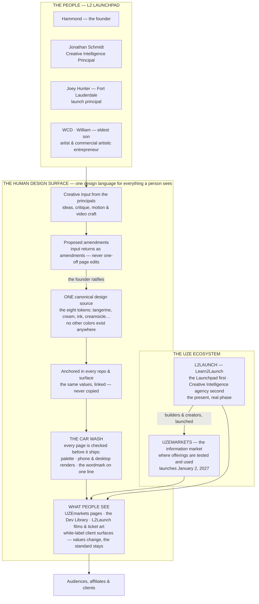
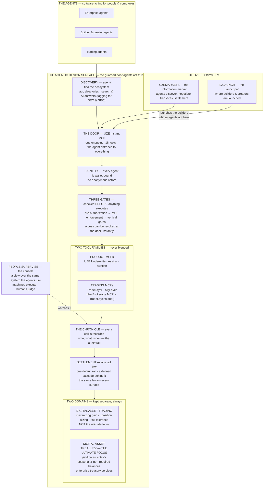
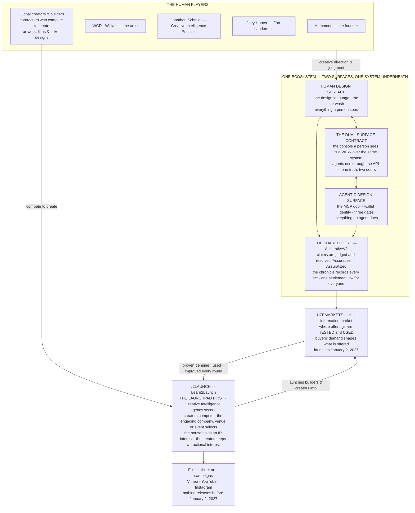

# The UZE Ecosystem, Mapped — Three Diagrams

**For:** Jonathan Schmidt — Creative Intelligence Principal
**Date:** 2026-11-19

Three diagrams, drawn from the two design-surface documents — the
*Human Design Surface for UZE Ecosystem* and the *Agentic Design
Surface for UZE Ecosystem*:

1. **What the ecosystem is, and how the HUMAN design surface flows through it** — the design language every person sees and touches.
2. **The same ecosystem, and how the AGENTIC design surface flows through it** — the surface built for software agents (programs that do business on behalf of people and companies). If "agentic" is a new word: it simply means *built for agents to act through*.
3. **The composite** — the two surfaces woven together over one shared core.

This cut is framed on **UZE and L2Launch** — the Launchpad and the
information market — which is where your seat is.

---

## Diagram 1 — The ecosystem, and the human design surface flowing through it

**How to read it:** Everything a human being ever sees from this ecosystem — a web page, a film, a ticket, a client's white-label site — comes from **one** set of design values, held in one place. Nobody edits a page directly: creative input from William, Jonathan, and Joey comes back as *amendments* to that one source, the founder ratifies them, and every surface updates from the source. Before anything ships, it goes through the **car wash** — an automatic check that the colors are only the eight allowed, that it looks right on a phone and a desktop, and that the wordmark sits on one line.

---

## Diagram 2 — The ecosystem, and the agentic design surface flowing through it

**How to read it:** More and more business is done by software agents — programs working for companies and people. This surface is the ecosystem's front door *for them*. An agent finds us (directories and AI search), arrives at one door (the **UZE Instant MCP**), proves who it is (its identity is bound to a wallet), and passes **three gates before anything it asks for is executed**. Every single call it makes is written into the **chronicle** — a permanent record. Money settles under one law, the same on every surface. Behind the door sit two tool families that are never mixed — the *product* tools (underwriting, assigning, auctioning) and the *trading* tools — and two money domains that are never mixed either: **trading** (gains, sizing, risk — real, but *not* the focus) and **treasury** (putting a company's idle cash balances to work, safely and on the record — **the ultimate focus**). People never lose the thread: the console a human looks at is a view over the very same system, and judgment stays human.

---

## Diagram 3 — The composite: UZE + L2Launch, both surfaces woven together

**How to read it:** This is the whole play on one page. **L2Launch builds it** — the Launchpad launches builders and creators, and its Creative Intelligence agency runs the competitions where global creators produce the films, artwork, and ticket designs that companies, venues, and events select. **Assurative makes it trustworthy** — claims are judged and resolved in the shared core, and every act, human or agent, is on the chronicle. **UZE Markets is where it's tested and used** — buyers' demand shapes what gets offered, and what is offered is proven genuine. The two surfaces are not two systems: they are **two doors into one system**. People walk through the human door — one design language, washed before it ships. Agents walk through the agentic door — identity, gates, record. Underneath, the same core serves both, and the money settles the same way for everyone.
