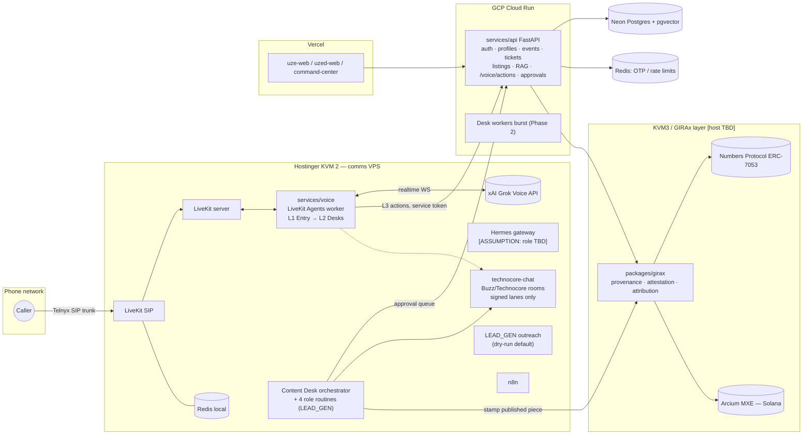

# UZE: Consolidated Development Specification (v0.1)

**Date:** 2026-10-17 · **Status:** DRAFT for approval · **Owner:** Hammond Dugan
**Builder:** MUZE agent SoSem (plus team) · **Gate:** Tuesday 2026-11-10 (per-surface go-live decision)
**Consolidates:** `docs/KVM2-AGENTIC-VOICE-SPEC.md`, `docs/SOCIALFI-VOICE-DUAL-SCOPE.md`,
`docs/CONTENT-DESK-CHARTER.md`, branch doc `CONTENT-DESK-TREE-PROVENANCE-PRIORITIES-2026-10-17.md`,
and the Oct 13–15 GIRAx/KVM3 architecture notes (`packages/girax/README.md`, `docs/ARCHITECTURE.md`,
`docs/NUMBERS-ARCIUM-PROVENANCE.md`). Findings and their evidence are in `REVIEW.md`.

> **Conventions.** Content read from the repo is cited `file:line`. Anything inferred is tagged
> **[ASSUMPTION]**, and anything needing a human decision is tagged **[DECISION]** and repeated in §11.
> Where the source docs say a decision came "per James", this spec keeps the attribution. The approver
> identity is an open question (§11, Q1).
> Where this spec overrides a source doc, it says **Supersedes**.

---

## 1. Goals

1. **G-A SocialFi onboarding:** email → OTP → 20-second profile → referral identity, deployed and usable
   (`SOCIALFI-VOICE-DUAL-SCOPE.md:12-13`).
2. **G-B KVM2 agentic voice:** an inbound phone concierge on Grok Voice. L1 hospitality entry hands off
   warmly to L2 specialist desks, and L3 executes backend actions (`KVM2-AGENTIC-VOICE-SPEC.md:9-43`).
   Voice-only, with no web marketing surface until the publish decision (`:84-95`).
3. **G-C Content Desk:** an orchestrator plus four roles in `DEVBUILDSTACK/LEAD_GEN`, tenant-scoped, with a
   human approval gate before anything is published (`CONTENT-DESK-CHARTER.md:9-81`). The first tenant is
   `l2launch`. The lead pillar is TREE plus privacy-powered provenance (priorities doc §3).
4. **G-D KVM3 / GIRAx:** the provenance/attestation layer the Desk and marketplace consume, prototyped on
   testnet/devnet only (§8).
5. **G-E Commercial:** "affordable paid subscriptions by Nov 10" (user's chat, unverified). **No source doc
   defines this.** It's a placeholder milestone (M5) pending [DECISION] Q2.

## 2. Scope and non-goals

**In scope through Nov 10, 2026:** G-A deployed on Cloud Run + Neon; G-B MVP (L1 + one desk, GIRA, + read/hold-only
L3) on KVM2 in test mode; G-C one loop up to the approval step; G-D design + devnet prototype; G-E billing
designed and sandbox-tested.

**Non-goals (carried over from the source docs):**
- No wallet, KYC, tokens or chain language inside the 20-second onboarding (`SOCIALFI-VOICE-DUAL-SCOPE.md:39`).
- No voice/concierge marketing surface on uze-web, uzed-web or public marketing (`KVM2…:91-93`). See Q6 about
  the existing `/guidance` pages.
- No publishing without human approval, no cross-tenant visibility, and ≤5 routines, proven one at a time
  (`CONTENT-DESK-CHARTER.md:125-130`).
- No production sends, paid API usage, live ad spend or mainnet transactions before the Nov 10 gate
  (`CONTENT-DESK-TEAM-SKILLS-PLAN.md:60-71`).
- No physical-market services outside Miami–Fort Lauderdale–Palm Beaches through Q2 2027 (`KVM2…:77-80`).
- Consumer copy free of tokens, chains and "super-intelligence"; the name is GIRA, never SURA (`CONTRIBUTING.md:4-6`).

**Added non-goals (this spec):** no money movement from any agent (voice or Desk) before an A4 approval flow
exists (§6.2). No outbound AI-voice calls before Nov 10. Sealed bids, payouts and settlement stay out of the voice MVP.

## 3. Architecture



**Placement rules:**
- **KVM2** runs real-time comms and agent control planes (`CONTENT-DESK-CHARTER.md:21-35`;
  `AGENT-CHAT-C3-EVALUATION.md:19,48-49`).
- **Cloud Run + Neon** is the system of record for the API, auth, audit and approvals (`DEPLOY.md:9-18`). technocore-chat is
  never used for auth, durability, moderation or payments (`AGENT-CHAT-C3-EVALUATION.md:50-51`).
- **Vercel** hosts the web apps.
- **KVM3** is the GIRAx on-chain layer (`packages/girax/README.md:5`). Whether it's a separate VPS is
  [DECISION] Q8. Hostinger sells KVM 1/2/4/8 only, so "KVM3" is a name, not a plan tier.

## 4. Voice (KVM2): components and interfaces

### 4.1 Levels
| Level | Responsibility | MVP (by Nov 10) | Later |
|---|---|---|---|
| **L1 Entry** | Greeting, AI + recording disclosure, intent, caller verification, emergency script, warm handoff. Male voice personas, per the source (`KVM2…:13,105`). | 1 L1 agent, EN + `es-MX`/`es-ES` + `pt-BR` [ASSUMPTION: regional variants; Grok requires them] | More languages per market |
| **L2 Desks** | GIRA (concierge/marketplace), GIRAx (resale), ONE (assets/sealed-bid), SoSim (DJ talent), SoSim Sisters (South Florida contractors) (`KVM2…:24-30`) | **GIRA only** | The other four desks, one at a time |
| **L3 Execution** | Executes what L2 arranged, never negotiates (`KVM2…:35-43`) | Read lookups + "create request/hold" only | Cancel, list, book, then settle (after A4 + settlement exist) |

**Supersedes:** "all markets, all languages" (`KVM2…:18`). Coverage is limited to the languages listed and to the South Florida physical scope.

### 4.2 Runtime
- A LiveKit Agents (Python) worker in `services/voice`, using the xAI realtime plugin (`livekit-agents[xai]`,
  `XAI_API_KEY`, model `grok-voice-latest`). Pinning a version for production is [ASSUMPTION].
- Telnyx FQDN SIP trunk → self-hosted LiveKit SIP. Outbound (later) sends `X-Telnyx-Username`.
- Desks are implemented as LiveKit agent handoffs inside one session. Context is passed in-process. [ASSUMPTION:
  this replaces "agent-chat protocol between desks" (`KVM2…:66-67`) for the live call path. technocore-chat stays
  for asynchronous desk coordination.]
- **Hermes gateway:** role is undefined in the repo. If it's the Nous Research Hermes Agent gateway, choose *one*
  turn-taking owner, either LiveKit Agents or Hermes `voice_server`. [DECISION] Q9.

### 4.3 Call context (shared by L1 → L2 → L3)
```json
{
  "call_id": "lk-room-sid",
  "started_at": "ISO-8601",
  "caller": {"phone_e164": "+1305…", "user_id": "uuid|null", "verified": "none|otp|known_number"},
  "consent": {"recording": true, "ai_disclosed": true, "whatsapp_optin": false},
  "language": "en|es-MX|es-ES|pt-BR",
  "market": "south-florida|other",
  "intent": {"desk": "GIRA", "summary": "…", "entities": {}},
  "handoffs": [{"from": "L1", "to": "GIRA", "at": "ISO-8601", "reason": "…"}],
  "emergency": false
}
```
The context is persisted to Postgres (`CallSession`) when the call ends. Transcripts follow the retention rules in §6.3.

### 4.4 L3 action API (new, on `services/api`)
`POST /voice/actions` · auth: a service JWT with `role=agent` and scopes · header `Idempotency-Key`.
```json
{"call_id":"…","action":"lookup_booking|create_hold|create_request","user_id":"uuid",
 "caller_verified":"otp","params":{}}
```
→ `APIResponse{status: done|pending_approval|rejected, ref}`. Any action that moves money or is irreversible
returns `pending_approval` and creates an `ApprovalRequest` (§6.2). Every call is written to `AuditLog`.

### 4.5 Call flows
MVP covers flow 1 (marketplace assist) as **lookup + request**, with the cancel/resell executed by an operator. Flows 2–5
(`KVM2…:47-59`) are deferred until their desks and endpoints exist. Confirmation goes by voice; WhatsApp only after opt-in
and the Meta account go-live (Q4).

## 5. Data and provenance

### 5.1 Schema deltas (Prisma, via `prisma migrate`, not `db push`)
- `User`: + `role` (`user|operator|agent|admin`), `phoneE164` (unique, nullable), `phoneVerifiedAt`,
  `whatsappOptInAt`, `voiceCallbackConsentAt`. `referredBy` must match an existing `referralCode` and can't be the user's own.
- New: `CallSession` (§4.3), `ApprovalRequest` (`level`, `requested_by`, `account`, `amount`, `asset`, `timing`,
  `status`, `approved_by`, `approved_at`), `AuditLog` (append-only), `DocumentChunk` + `approvedAt`, `desk`, `ingestedBy`.
- LEAD_GEN: `tenant_id` on every Desk table, `content_item` (brief/claim/draft/approval/publish states), `claim_check`.

### 5.2 API hardening (required before deploy)
- Typed inputs only; no `payload: dict`.
- Owner taken from the token.
- Operator routes behind `require_role`.
- `buy`/`payout` return `501` until settlement + A4 exist (`REVIEW.md` S1–S4).

### 5.3 Provenance record (Content Desk → GIRAx)
Fields per published piece: `content_id`, `tenant_id`, `source_urls[]`, `claim_checks[] {claim, verdict
(supported|partly|unverified|misleading), primary_source, caveat}` (`CONTENT-DESK-CHARTER.md:57-59`),
`approved_by`, `approved_at`, `sha256`, `numbers_nid` (ERC-7053) [testnet until gate], `attestation_tx` [devnet].
KYC/KYB of the publishing entity is out of scope before Nov 10 [ASSUMPTION].

## 6. Security, approvals, compliance

### 6.1 Roles (API)
| Route group | user | agent (voice/Desk) | operator | admin |
|---|---|---|---|---|
| profiles (own), tickets (own) | ✅ | via `/voice/actions` scopes | ✅ | ✅ |
| listings create/buy (own) | ✅ (buy = 501) | request only | ✅ | ✅ |
| listings moderate / flagged | — | — | ✅ | ✅ |
| auction bids read | — | — | after close | ✅ |
| RAG ingest | — | — (proposes) | ✅ approves | ✅ |
| approvals decide | — | — | A2/A3 | A4 |

### 6.2 Approval levels (renamed to end the L-level collision)
**Supersedes** Content Desk "L0–L4" (`CONTENT-DESK-CHARTER.md:74-81`). The semantics are unchanged:
- **A0** read · **A1** prepare (research, draft, queue): autonomous.
- **A2** reversible internal write, tenant-scoped: autonomous.
- **A3** external action (post, publish, send, outbound call/message): human approval, always.
- **A4** money / irreversible: per-action approval naming account, amount, asset and timing. No standing authority.
Voice L1/L2/L3 keep their names. Voice L3 actions map to A2 (holds/requests) or A4 (payments, cancellations with refunds).

### 6.3 Compliance checklist (voice + messaging)
- AI + recording disclosure at the **start** of L1. Florida is an all-party-consent state (Fla. Stat. §934.03;
  confirm with counsel). **Supersedes** "before L2" (`KVM2…:71`).
- Outbound AI-voice calls/callbacks need prior express consent under the TCPA (FCC-24-17). None before Nov 10.
- WhatsApp: opt-in recorded; business-initiated messages use approved templates; scope limited to transactional
  follow-ups (Meta bars general-purpose AI assistants as the primary use).
- Emergency: L1 tells the caller to hang up and dial 911, flags the call and alerts the operator on duty. The agent never claims to dispatch help.
- Retention [ASSUMPTION]: recordings 30 days, transcripts 90 days, audit logs indefinite. Approver to confirm.
- Secrets: names only in `CREDENTIALS-REGISTRY.md`. Values live in GCP Secret Manager or the team vault; on KVM2, a
  root-only `.env` per service (`/opt/uze/<svc>/.env`, mode 600).
- LEAD_GEN: every live send passes the triple gate (`--live` + `LEADGEN_ALLOW_LIVE=1` + credentials) and the suppression check.
  The legacy `send_emails.py` must comply or be removed.

## 7. Infrastructure and deployment per host

| Host | Runs | Ports / network | Deploy | Notes |
|---|---|---|---|---|
| **KVM2** (Hostinger KVM 2: 2 vCPU, 8 GB, 100 GB NVMe, 8 TB; $8.99/mo on 24-month term, renews at $14.99) | LiveKit server + SIP, Redis (local), `services/voice`, Hermes [TBD], technocore-chat (network-isolated), n8n, LEAD_GEN cron, Desk orchestrator + routines | Public: 443/tcp, 5060/udp+tcp (SIP), 10000–20000/udp (RTP), LiveKit WebRTC ports. Everything else bound to localhost/VPN. SSH key-only. | Docker Compose, pulled from GHCR/Artifact Registry by a deploy script [ASSUMPTION: no CI target exists yet] | Heavy jobs (scrape/render) outside voice peak hours (`CONTENT-DESK-CHARTER.md:29`). **Capacity unknown until load test (M2).** Rendering (Remotion/video) moves to Cloud Run if it contends with voice. |
| **Cloud Run** | `services/api`; later Desk worker burst | HTTPS | `.github/workflows/deploy.yml` (existing) | Secrets from Secret Manager (`DEPLOY.md:30-31`) |
| **Vercel** | uze-web, uzed-web, command-center | HTTPS | existing `web-vercel` job | `NEXT_PUBLIC_API_BASE_URL` only |
| **Neon / Redis** | Postgres + pgvector; OTP/rate limits | TLS | managed | `DATABASE_URL`/`DIRECT_URL`/`REDIS_URL` |
| **KVM3** [DECISION Q8] | GIRAx services (indexer, attestation signer on devnet) | TBD | TBD | No mainnet keys before the gate |

**Ops minimums for KVM2:** uptime checks on SIP/API/LiveKit; container logs shipped off-box; nightly backup of
n8n, LEAD_GEN DB and configs; restart policies; a one-page runbook (restart, rotate keys, disable voice line).

**Cost model (public list prices, 2026-10-17) [ASSUMPTION: inbound local, self-hosted LiveKit]:**
Grok Voice S2S $0.08/min + Telnyx inbound from $0.0032/min ≈ **$0.083/min**. Phone number $1/mo. KVM2 $8.99–14.99/mo.
Example: 1,000 minutes/month ≈ $83 in voice + ~$10–16 fixed. Subscription pricing (Q2) must cover the expected minutes per subscriber.

## 8. KVM3: GIRAx on-chain layer (drafted from the Oct 13–15 notes)

**What the repo says:**
- "KVM3 = the GIRAx on-chain layer (renamed from Assurative.ai architecture), on-chain to physical layer"
  (`packages/girax/README.md:5`, commit `6858180`, 2026-10-13).
- Purpose: artist/creator provenance and IP protection: innovation, attestation, attribution, authentication,
  affiliate, blockchain (`:3`).
- Numbers Protocol provenance (Nid/CID, NFT metadata, on-chain licenses, royalty distribution) (`:6`). Arcium MPC as the verifiable
  execution layer, with sealed-bid auctions as the documented MPC use case (`:7`).
- Oct 15 note: Arcium via **Cerberus MPC, not TEEs**; Numbers per ERC-7053; purpose is fractional attribution and
  programmatic revenue share (`NUMBERS-ARCIUM-PROVENANCE.md:13-41`).
- Status: no contracts deployed; prototype → testnet → audit → mainnet, each step gated by approval (`:43-47`).
- The Desk is "the first production consumer of the GIRAx Layer's trust primitives" (`CONTENT-DESK-CHARTER.md:88-89`).
- Related chain direction (Oct 13): Solana primary (USDC x402), LightLink L2 for EVM NFT tickets (`ARCHITECTURE.md:39-61`).
- The TREE layer lives in `DEVBUILDSTACK/LAYER_TREE` (priorities §3). It wasn't reviewed here.

**Components (proposed) [ASSUMPTION unless cited]:**
1. `girax-provenance`: registers an asset (sha256 → Numbers commit, `numbers_nid`) and reads history. Testnet first.
2. `girax-attest`: writes the claim-check trail hash (§5.3) as an attestation on Solana devnet. The signer key is
   devnet-only and held outside the repo.
3. `girax-auction` (later): an Arcium MXE sealed-bid program for the ONE desk, based on the Arcium sealed-bid example.
   Not in MVP; until then the API's `/auctions` must not be called "sealed" (bids are readable today).
4. `girax-attribution` (later): referral/affiliate attribution to originators → UZD payouts (A4).

**Interface:** `POST /girax/provenance {content_id, sha256, tenant_id}` → `{numbers_nid, commit_tx}`;
`POST /girax/attest {content_id, claim_trail_hash}` → `{attestation_tx}`; `GET /girax/provenance/{content_id}`.
Called by the API and the Desk orchestrator only (role `agent`/`operator`).

**Open:** MPC-vs-TEE is marked "still open" in `packages/girax/README.md:8` but decided in the Oct 15 doc (Q7).
Host (Q8). Which chain the attestation lands on, Solana or EVM via Numbers (Q10).

## 9. Milestones (to the Nov 10 gate)

| # | Window (ET) | Milestone | Depends on |
|---|---|---|---|
| **M0** | Oct 19–21 | Safety fixes: RBAC, typed inputs, payout/buy 501, OTP verify limit, LEAD_GEN send gate | — |
| **M1** | Oct 22–28 | Track A deployed: migration, Resend domain verified, secrets loaded, onboarding pages, phone + consent capture | Neon/GCP/Resend secrets (`SECRETS-TRIAGE.md`) |
| **M2** | Oct 26–Nov 4 | Voice MVP on KVM2: Telnyx→LiveKit SIP→L1→GIRA→`/voice/actions` (lookup/request); load test recorded | KVM2 SSH access; Telnyx/LiveKit/xAI keys (`CREDENTIALS-REGISTRY.md:58-62`) |
| **M3** | Oct 22–Nov 4 | Content Desk: LEAD_GEN scaffold + tests + tenant guard; one TREE piece brief→claim-check→draft→**approval queue** | — |
| **M4** | Nov 2–6 | GIRAx devnet/testnet: provenance + attestation of the M3 piece's hash | Q7, Q8, Q10 |
| **M5** | Nov 2–9 | Subscription: product/price/rail defined, sandbox checkout + entitlement check | **Q2** |
| **Gate** | **Tue Nov 10** | Approver reviews evidence per surface and authorizes each live surface individually (`CONTENT-DESK-TEAM-SKILLS-PLAN.md:69-71`) | All above |

The Meta Business account (target Nov 5, `KVM2…:100`) may be *set up* in sandbox. Live WhatsApp sends wait for the gate (Q4).

## 10. Acceptance criteria

**M0:** Automated tests show a fresh OTP user gets `403` on moderate/flagged/bids/payout/ingest. Bidding with a
foreign `bidderId` is ignored. The 6th wrong OTP burns the code. `send_emails.py` refuses without the triple gate and skips suppressed addresses.

**M1:** On staging, a new email reaches a profile with a handle and referral code in ≤ 3 screens. OTP email arrives with SPF/DKIM/DMARC
passing. `prisma migrate deploy` runs clean. `/health/deep` is green. Phone verified, consent timestamps stored. Public profile
returns no email/phone.

**M2:**
- 20 scripted test calls (EN/ES/PT):
  - ≥ 95% hear the disclosure in the first turn;
  - ≥ 90% route to GIRA correctly on GIRA intents;
  - 100% of handoffs carry the §4.3 context (no re-asking for name or intent);
  - an emergency phrase triggers the 911 script and an operator alert in 100% of cases.
- p50 response latency is measured and recorded. [ASSUMPTION target: ≤ 1.5 s from end of caller speech.]
- Load test records the maximum concurrent calls on KVM2 with CPU < 80%.
- No money-moving action is reachable.

**M3:**
- LEAD_GEN tests pass in CI.
- A cross-tenant read test fails closed.
- One piece shows source links, ≥1 claim-check verdict with primary source + caveat, three openings, and the
  most-challengeable claim flagged (`CONTENT-DESK-CHARTER.md:52-65`).
- The piece sits in the approval queue with its scheduled slot.
- Nothing is published without an approval record.

**M4:** The piece's sha256 has a Numbers testnet Nid and a devnet attestation tx, both retrievable via `GET /girax/provenance/{id}`.
No mainnet keys exist on any host.

**M5:** A sandbox subscriber completes checkout and gets the entitlement. Cancel revokes it. Price per tier is documented against the
§7 unit cost.

**Gate:** A written evidence pack per surface (api, voice, desk, girax, billing). Each surface is approved or held individually.

## 11. Open questions (consolidated)

1. **Approver:** RESOLVED 2026-10-17. James (Project Lead, `CREDENTIALS-REGISTRY.md:21`) is Hammond Dugan, and he is the approver for A3/A4 and the go-live gate.
2. **Subscriptions:** What's sold on Nov 10 (voice concierge? Content Desk? creator tools?), at what tiers/prices, and on which
   billing rail (card processor vs x402/USDC)? Several docs say "no subscriptions, pure usage" (`AFFILIATE-CONTENT-NETWORK-OVERVIEW.md:35-36`).
3. **One loop before Nov 10:** Is one organic, human-approved post on @l2launch allowed, or does the loop stop at the queue?
4. **WhatsApp:** Is a live Meta Business/WABA allowed Nov 5–10, or sandbox only until the gate?
5. **Human staff:** Is there any human hire or call-center transfer (`CONTENT-DESK-TEAM-SKILLS-PLAN.md:10` vs `:82`; `GROWTH-SUITE-OVERVIEW.md:51-53`)? If humans join L1, re-check the male-only rule with counsel.
6. **GIRA on the web:** Keep or remove the existing `/guidance` pages given the voice-only rule?
7. **MPC vs TEE:** Is it final (Cerberus MPC per Oct 15)? Then update `packages/girax/README.md:8`. Does ONE use Arcium from day one (`KVM2…:106`)?
8. **KVM3:** Is it a separate VPS (which Hostinger plan; there's no KVM 3 tier) or a logical layer? Is "KVM2" the plan name or a host label?
9. **Hermes:** What exactly is the "Hermes Native Gateway" (Nous Research Hermes Agent?) and which component owns turn-taking?
10. **Attestation chain:** Solana devnet, the Numbers chain, or LightLink?
11. **Missing docs:** Where are the "stack spec", "treasury spec", "i18n spec", "KVM2 plan" and `GROK-VOICE-x402-WAAS-SPEC-v1.0.md`?
12. **Agent count:** The charter caps routines at five, but later docs add 7 agents, 10 skills and 7 personas. Which are in scope before Nov 10?
13. **Envoy lane:** @DecensatDesign or UZE corporate?
14. **External reporting:** What data may go in the weekly report to an outside personal Gmail?

## Notes for SoSem (ambiguity guardrails)
- Don't build desks other than GIRA, settlement, sealed bids, payouts or outbound calls before their open question is answered.
- When a source doc conflicts with this spec, follow the **Supersedes** notes here. Anything else that's unclear goes in §11, not into code.
- Keep the content-desk-priorities branch separate from the sports-taxonomy schema changes before opening a PR (`REVIEW.md` C14).
