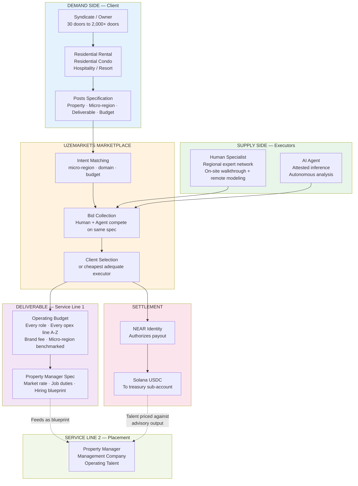

<!--
  Repo:       DevBuildStack/UZEMARKETS
  Branch:     hackathon/nov-2026
  Sprint:     1.5 (Hackathon, Nov 2026)
  Merges to:  main by 2026-11-13 EOD Eastern
  Supersedes: none (additive — Sprint 2 seeds this content)
  Audience:   Real estate partners, financial analysts, non-technical stakeholders
-->

# Marketplace Flow — Business View

Two service lines, one marketplace. The advisory produces the operating budget and the property manager spec; the placement fulfills it. The human specialist and the AI agent compete on the same specification, and the client chooses.

What to read off this diagram

· The demand side never chooses a vendor. It posts a specification, and the marketplace routes.
· Human and agent sit at the same level. The agent competes on the same spec.
· Service Line 1 produces two artifacts: the operating budget and the PM spec.
· Settlement is one rail: NEAR authorizes, Solana settles.
· The dotted arrows are the compounding asset: the advisory output prices the talent.
