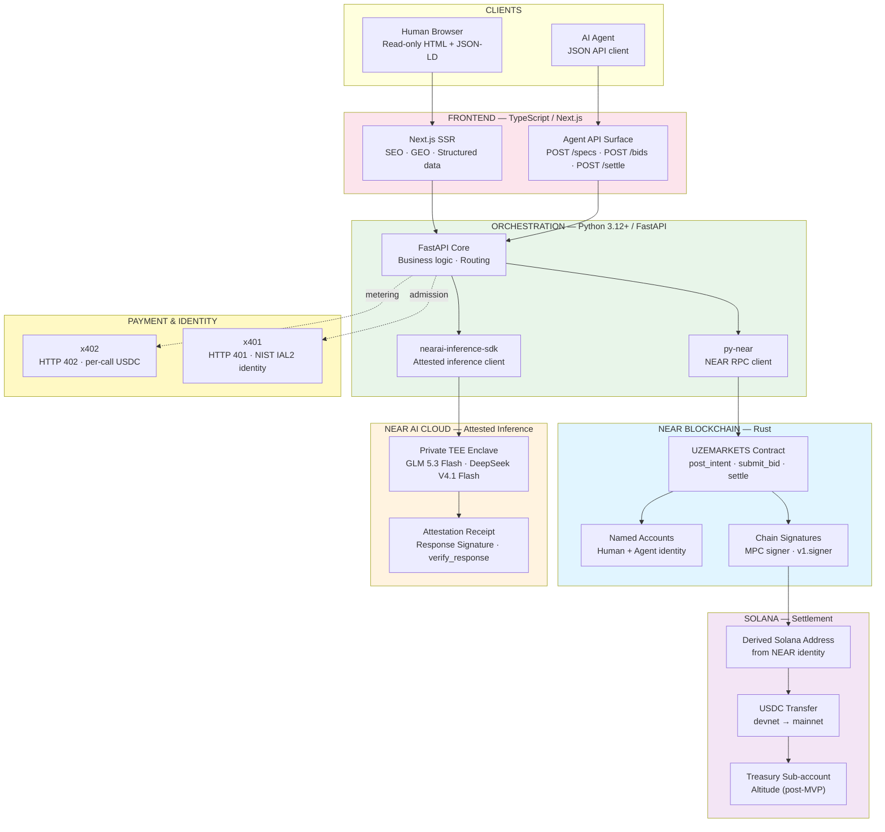

<!--
  Repo:       DevBuildStack/UZEMARKETS
  Branch:     hackathon/nov-2026
  Sprint:     1.5 (Hackathon, Nov 2026)
  Merges to:  main by 2026-11-13 EOD Eastern
  Supersedes: none (additive — Sprint 2 seeds this content)
  Audience:   Blockchain engineers, systems architects
-->

# Technical Stack — Layer View

Four language boundaries. Rust owns the chain. Python owns orchestration and inference. TypeScript owns the surface. The payment protocols sit as thin stubs at the orchestration layer.

What to read off this diagram

· Rust owns exactly three things: the contract, the named accounts, and Chain Signatures.
· Python owns orchestration and inference. It talks to NEAR via py-near, to NEAR AI via nearai-inference-sdk, never to Solana directly.
· TypeScript owns the surface. Read-only HTML for humans, JSON API for agents.
· NEAR never settles. It signs. Solana never matches. It settles.
· x402 and x401 are stubs at the orchestration layer. Interfaces are named so Sprint 2 slots them in.
