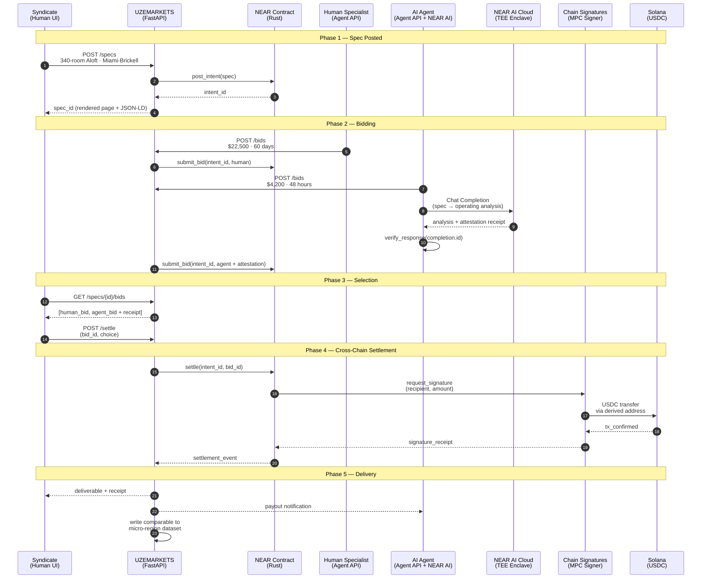

<!--
  Repo:       DevBuildStack/UZEMARKETS
  Branch:     hackathon/nov-2026
  Sprint:     1.5 (Hackathon, Nov 2026)
  Merges to:  main by 2026-11-13 EOD Eastern
  Supersedes: none (additive — Sprint 2 seeds this content)
  Audience:   Both — business and engineering
-->

# End-to-End Sequence — The Demo Walkthrough

Five phases, two solvers, one settlement, one deliverable.

What to read off this diagram

· The agent's bid is not a promise — it is backed by an executed inference call. verify_response fires before the bid is submitted.
· Chain Signatures sits between the contract and Solana. The marketplace never touches Solana directly.
· Phase 5 writes the comparable. This is the moment the business compounds.
