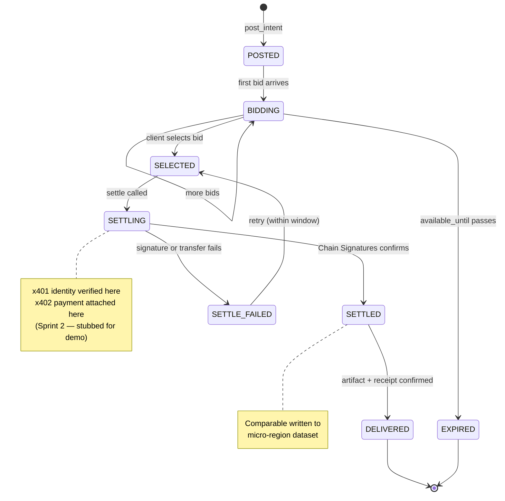

<!--
  Repo:       DevBuildStack/UZEMARKETS
  Branch:     hackathon/nov-2026
  Sprint:     1.5 (Hackathon, Nov 2026)
  Merges to:  main by 2026-11-13 EOD Eastern
  Supersedes: none (additive — Sprint 2 seeds this content)
  Audience:   Rust contract engineers, backend engineers
-->

# Intent Lifecycle — Contract State Machine

The states the Rust contract must enforce, and nothing else.

What to read off this diagram

· Five active states plus two terminal branches. Every other state is a bug.
· SETTLE_FAILED returns to SELECTED, not BIDDING. The client's choice is preserved.
· EXPIRED is terminal. No resurrection, no late bids.
· The two notes mark the two phase-boundaries: x401/x402 fire during SETTLING; the comparable write fires during SETTLED.
