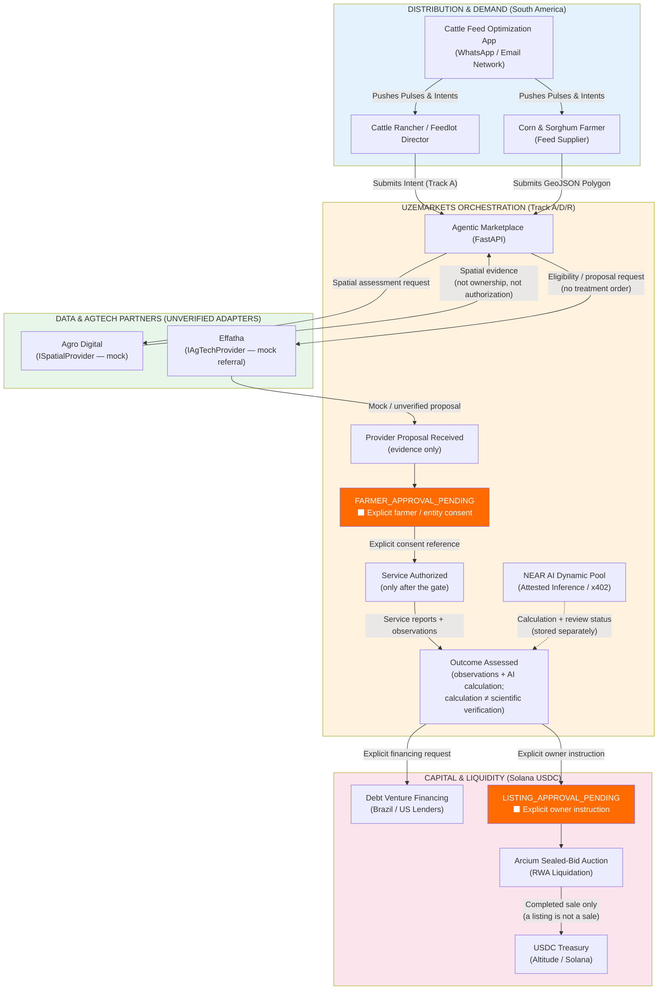
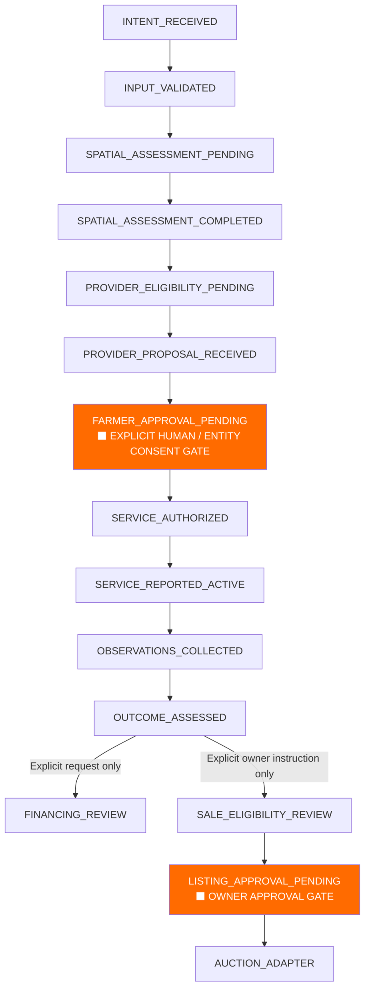

<!--
  Repo:       DevBuildStack/UZE
  Branch:     hackathon/nov-2026
  Sprint:     1.5 (Hackathon, Nov 2026)
  Audience:   SoSem (Implementing Agent), Engineers
  Purpose:    Visualizes the integration of Effatha (AgTech), Agro Digital (Spatial Data), and the Cattle/Feedlot distribution across the A/D/R tracks in South America.
-->

# The Americas Ag-Cattle Optimization & Financing Stack

This diagram maps the dual-track strategy for the South American agricultural market (specifically Brazil, Paraguay, and Uruguay). We are using the cattle/feedlot network as the distribution wedge to acquire farmers, using partners like Agro Digital for underwriting and Effatha for yield optimization, and routing the resulting economic value to either debt financing or RWA auctions.

The Technical Stack Mapping (For SoSem)

Here is the exact translation of the diagram into the codebase:

1. The Distribution Wedge: The Cattle Feed Optimization App acts as our external trigger. It fires POST /api/v1/webhooks/agriculture/intent into our system, carrying the farmer's details and the crop_type (CORN/SORGHUM). The webhook is authenticated, idempotent, and can enter only INTENT_RECEIVED → INPUT_VALIDATED.
2. The Spatial Engine (Agro Digital): UZEmarkets places Agro Digital behind an ISpatialProvider interface. The hackathon adapter is a local mock: it leaves the assessment pending and returns no fabricated CAR match, confidence score, or ownership conclusion. A completed spatial assessment is separate evidence; a GeoJSON/CAR match does not establish land ownership and does not authorize anything.
3. The Yield Engine (Effatha): Effatha sits behind an IAgTechProvider interface as a referral/eligibility adapter. No live treatment API is assumed. Its mock eligibility result is PROVIDER_ELIGIBILITY_PENDING; its mock proposal is PROVIDER_PROPOSAL_RECEIVED and is stored as a ProviderProposal evidence record. A proposal moves the referral only to FARMER_APPROVAL_PENDING.
4. The AI & Tracking: The NEAR AI layer writes an AIAssessment record with the model version, input evidence references, and calculation stored separately from review_status. Signed/attested does not mean scientifically verified: signed = true and scientifically_verified = true are separate fields, and recording a calculation does not move the referral or certify a yield gain.
5. The Capital Split (The Crossroad):
   · Path 1 (Optimize & Finance): Only after service authorization, service reporting, observations, and OUTCOME_ASSESSED may the farmer/entity make an explicit financing request into FINANCING_REVIEW.
   · Path 2 (Exit & Liquidate): Only after OUTCOME_ASSESSED may the owner give an explicit instruction into SALE_ELIGIBILITY_REVIEW → LISTING_APPROVAL_PENDING → AUCTION_ADAPTER. A macro_driver such as fiat_collapse or a succession flag is recorded as context/flag only — it never routes or lists the land by itself. A listing is not a sale, and auction execution remains distinct from USDC settlement.

---

## Evidence Gate (Governance Overlay — 2026-11-08)

The flow above is governed by `docs/specifications/06-EVIDENCE-GATED-ARCHITECTURE.md`. The marketplace proposes; it does not authorize. No macro signal and no AI estimate independently triggers an irreversible transaction — every Advisory → Execution transition passes the state ladder below, and the financing and sale branches are separately authorized.

Reading the two diagrams together: the distribution app may push an intent into INTENT_RECEIVED; the Agro Digital mock leaves its assessment pending, and only a separate evidence-carrying completion step can move it to SPATIAL_ASSESSMENT_COMPLETED — a spatial match does not establish ownership and authorizes nothing; Effatha's proposal is recorded as evidence and the referral then waits at FARMER_APPROVAL_PENDING until explicit farmer/entity consent authorizes a service; yield observations and AI calculations are evidence records, never self-certifying; and the Arcium auction adapter is reachable only through the sale branch's own approval gate. A listing is not a sale, and auction execution and USDC settlement remain distinct stages.
