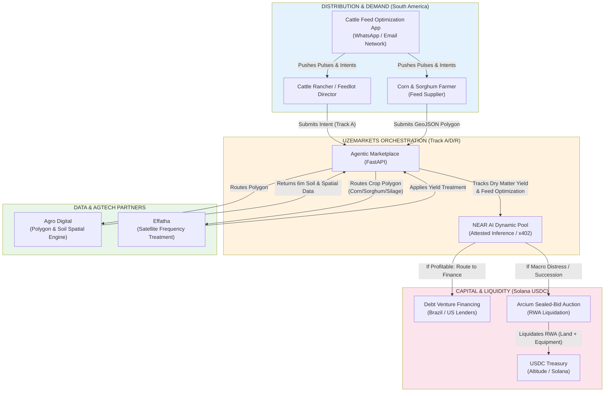

<!--
  Repo:       DevBuildStack/UZE
  Branch:     hackathon/nov-2026
  Sprint:     1.5 (Hackathon, Nov 2026)
  Audience:   SoSem (Implementing Agent), Engineers
  Purpose:    Visualizes the integration of Effatha (AgTech), Agro Digital (Spatial Data), and the Cattle/Feedlot distribution across the A/D/R tracks in South America.
-->

# The Americas Ag-Cattle Optimization & Financing Stack

This diagram maps the dual-track strategy for the South American agricultural market (specifically Brazil, Paraguay, and Uruguay). We are using the cattle/feedlot network as the distribution wedge to acquire farmers, using partners like Agro Digital for underwriting and Effatha for yield optimization, and routing the resulting economic value to either debt financing or RWA auctions.

The Technical Stack Mapping (For SoSem)

Here is the exact translation of the diagram into the codebase:

1. The Distribution Wedge: The Cattle Feed Optimization App acts as our external trigger. It fires POST /api/v1/webhooks/agriculture/intent into our system, carrying the farmer's details and the crop_type (CORN/SORGHUM).
2. The Spatial Engine (Agro Digital): UZEmarkets takes the GeoJSON polygon and routes it to the Agro Digital partner API. We need to ensure our target_area JSONB schema perfectly matches standard GeoJSON so it can be mapped to their CAR database.
3. The Yield Engine (Effatha): UZEmarkets routes the specific corn/sorghum polygon to Effatha for satellite treatment.
4. The AI & Tracking: The NEAR AI agent evaluates the baseline vs. the treated yield (Dry Matter & Digestibility). It signs the result via x401 and meters the compute via x402.
5. The Capital Split (The Crossroad):
   · Path 1 (Optimize & Finance): The farmer keeps the land. The verified yield data is passed to the financing_linkage pipeline for debt venture capital to fund the next planting season.
   · Path 2 (Exit & Liquidate): Triggered by macro_driver: "fiat_collapse" (e.g., Paraguay) or succession_trigger. The land and equipment are routed to the Arcium Sealed-Bid Auction to extract USDC.
