# Diagram 06 — Assuraties: Claim → Judge → Assuratized

The claim-resolution flow for UZEmarkets HiCRE and ANR&D RWA, adapted from the
Credence claim-market concept (MIT) and extended for property claims, period
financials, and confidential auctions. Terminology: **Assuraties** = claims as
issued and standing (plural-only). **Assuratized** = claims confirmed in
resolution through the market parties. **ASSURATIZED @ARCIUM** = the same
standard concluded inside the Arcium MPC encrypted supercomputer (its TEE).

Two claim origins, differentiated by attributes:

- **Owner claims** — asset facts and financials the owner stands behind:
  the asset itself, and its period total operating expenses — monthly,
  quarterly, annual — plus historicals in total. Historicals are backward-
  looking and evidential (fact to be proven); projections are forward-looking
  (claims to be judged and, over time, settled against actuals).
- **Broker claims** — market-facing assertions a broker stands behind:
  representations made to the market about an asset they do not own —
  marketed occupancy, expense ratios, price guidance, condition statements.
  Same bond, same judge, same resolution; the claimant's role and the claim's
  attribute set differ.

```mermaid
flowchart TD
    subgraph ORIGIN["1 · Origination — a human or an agent introduces the market"]
        O1["OWNER introduces claims<br/>asset facts · period total operating expenses<br/>monthly / quarterly / annual + historicals in total<br/>(historicals = evidential, backward · projections = forward)"]
        B1["BROKER introduces claims<br/>market-facing representations<br/>occupancy · expense ratios · price guidance · condition"]
        A1["ADVISOR / AGENT introduces claims<br/>underwriting assertions from analysis<br/>(GIRA for A·N·R·D · SURA for HiCRE)"]
    end

    subgraph MARKET["2 · Market generation — the claim becomes Assuraties"]
        M1["Claim market created on NEAR<br/>introducer posts the claim + funds the market subsidy"]
        M2["BOND ESCROW (NEAR contract)<br/>introducer's bond stands behind the claim<br/>funding route: NEAR Intents, any chain"]
        M3["Open pricing — Assuraties standing<br/>live price = market confidence in the claim"]
        O1 --> M1
        B1 --> M1
        A1 --> M1
        M1 --> M2 --> M3
    end

    subgraph CHALLENGE["3 · Challenge — the market parties test the claim"]
        C1{"Challenged?"}
        C2["Challenger posts counter-bond<br/>dispute ladder: each dispute doubles the bond<br/>tentative outcome flips · window restarts"]
        C3["No challenge · window lapses<br/>= confirmation by the market parties"]
        M3 --> C1
        C1 -- "yes" --> C2
        C1 -- "no" --> C3
    end

    subgraph JUDGE["4 · Judgment — where REE and TEE conclude"]
        J1["TEE — NEAR AI juror in a trusted<br/>execution environment (attested enclave)<br/>judges the claim against the evidence"]
        J2["Juror report + TEE attestation receipt<br/>model · evidence shown · conclusion"]
        J3["REE — reproducible execution:<br/>deterministic re-judgment + receipt verification<br/>the verdict must reproduce to stand"]
        C2 --> J1
        C3 --> J1
        J1 --> J2 --> J3
    end

    subgraph RESOLUTION["5 · Resolution"]
        R1{"Verdict upheld<br/>and confirmed?"}
        R2["ASSURATIZED<br/>claim confirmed in resolution<br/>introducer's bond returned · challengers paid per ladder"]
        R3["RESOLVED FALSE<br/>claim fails · bonds settle to the prevailing side<br/>claimant track record marked"]
        R4["Assuratized ledger compounds<br/>comparables: proven period operating expenses<br/>by asset · period · micro-region + claimant reputations"]
        J3 --> R1
        R1 -- "yes" --> R2 --> R4
        R1 -- "no" --> R3
    end

    subgraph RELIANCE["6 · Reliance — financing partners"]
        L1["Reliance API serves ASSURATIZED claims only<br/>claim · price · bond · claimant track record · resolution trail"]
        L2["Private financing · bank / institutional lending<br/>commercial · development · agricultural · NR"]
        R4 --> L1 --> L2
    end

    subgraph AUCTION["7 · Confidential auction branch — assets with claims attached go to auction"]
        X1{"Asset to auction<br/>with Assuraties attached?"}
        X2["ARCIUM MPC — encrypted supercomputer (TEE)<br/>sealed bids stay encrypted end to end<br/>MPC computes the winner · nothing revealed but the result"]
        X3["ASSURATIZED @ARCIUM<br/>sealed-bid auction · reverse auction<br/>result + proof, bids never exposed"]
        M3 --> X1
        X1 -- "sealed bid / reverse" --> X2 --> X3
        X3 --> R4
    end
```

**Reading the flow.** The introducer — owner, broker, advisor, or agent —
creates the market and bonds the claim (2). Standing claims are Assuraties:
priced, bonded, challengeable (2–3). Challenges escalate by bonded ladder
until the claim reaches judgment, where the TEE leg (attested NEAR AI juror)
and the REE leg (reproducible re-judgment and receipt verification) together
conclude whether the claim stands (4). Confirmation by the market parties —
a lapsed window or a withstood challenge — makes it **Assuratized** (5), and
only Assuratized claims are served to financing partners through the Reliance
API (6). When an asset carrying claims goes to auction under sealed bids, the
auction concludes inside the Arcium MPC environment and carries the separate
mark **ASSURATIZED @ARCIUM** (7). No step in this flow moves settlement money:
settlement remains USDC on Solana, and resolution changes only the claim's
state (the Iron Rule).
