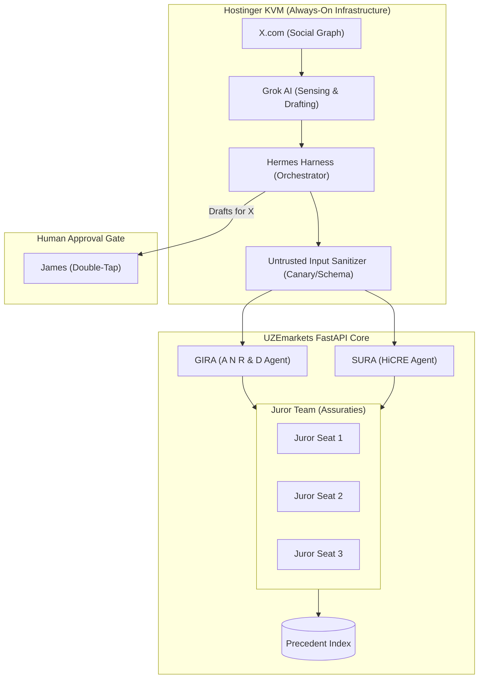

# Diagram 07 — The Multi-Agentic Team: Hermes Harness + Grok Sensing Layer

**Status: architecture for the Nov 15 Sprint 2 kickoff (DeepSeek directive,
relayed by James 2026-11-09). Spec: `docs/specifications/09-HERMES-AGENTIC-TEAM-ARCHITECTURE.md`.
The Hermes build does not begin until Nov 15.**

Filed as Diagram 07 (DeepSeek's package said 06; 06 is the Assuraties
claim-resolution diagram, filed 2026-11-09 — real paths govern).

**Reading the diagram.** The KVM is the always-on plane: Grok senses X,
Hermes orchestrates, and nothing Grok produces reaches the UZEmarkets core
without passing the sanitizer. Inside the core, GIRA and SURA underwrite
their tracks and escalate contested questions to the Juror Team, whose
resolutions write back to the Precedent Index — the shared memory every
later judgment reads. Drafts bound for X never publish from the harness:
they route to James, and only his Double-Tap sends them.
