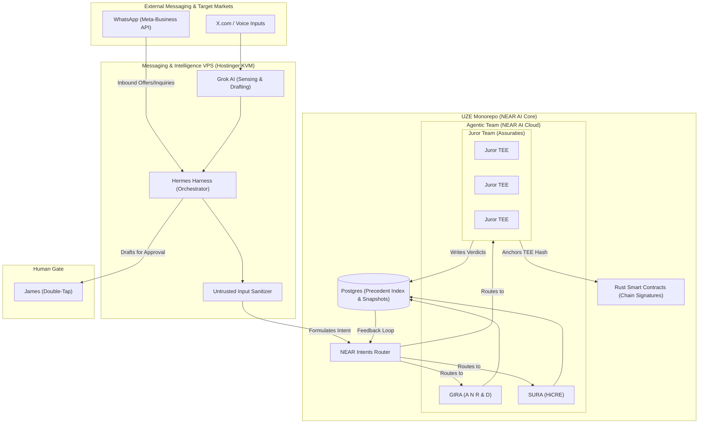

# Diagram 08 — Multi-Agentic Team & MIV Technical Architecture

**Status: architecture per DeepSeek's MIV/WhatsApp directive (relayed by
James, 2026-11-09). This version supersedes the earlier Diagram 08 (NEAR AI
core / KVM edge) filed the same day: the Messaging & Intelligence VPS (MIV)
and the Meta-Business/WhatsApp layer are now drawn explicitly. Spec:
`docs/specifications/10-NEAR-AI-CORE-INTENT-ROUTING-KVM-EDGE.md`.
Companion: Diagram 09 (WhatsApp business flow). The MIV/Hermes integration
is NOT built during hackathon week; Sprint 2 (Nov 15) begins it.**

**Reading the diagram.** Two inbound channels reach the MIV on the
Hostinger KVM: WhatsApp through the Meta-Business API (offers and
inquiries from the Brazilian business-owner network and the US East Coast
diaspora) and X/voice through Grok's sensing. Hermes orchestrates on the
MIV; everything it formulates passes the sanitizer before becoming a NEAR
Intent at the core's router. Inside the core, intents route to GIRA,
SURA, or the Juror Team; verdicts write to the Precedent Index and juror
TEE hashes anchor to the contracts. The edge holds no schemas, and drafts
for publication route to James's Double-Tap.
