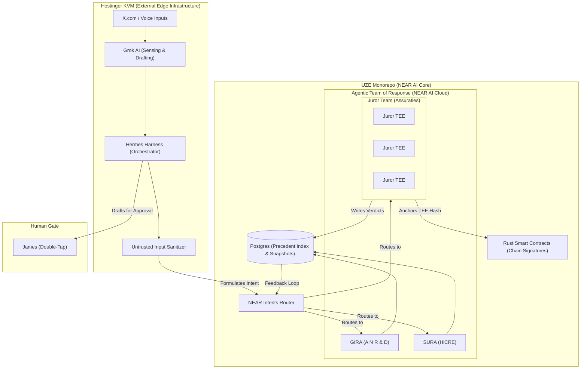

# Diagram 08 — NEAR AI Core, Intent Routing, and the KVM Edge

**Status: architecture per DeepSeek's refined directive (relayed by James,
2026-11-09). Spec: `docs/specifications/10-NEAR-AI-CORE-INTENT-ROUTING-KVM-EDGE.md`.
The KVM/Hermes integration is NOT built during hackathon week; Sprint 2
(Nov 15) begins it.**

Filed as Diagram 08 (the directive package said 06; 06 is the Assuraties
claim-resolution diagram and 07 is the agentic-team diagram — real paths
govern).

**Reading the diagram.** The hard line is between the two subgraphs. The
UZE monorepo is the NEAR AI-native core: intents are formulated and routed
inside it, the Agentic Team of Response runs on NEAR AI Cloud inference,
verdicts write to the Postgres Precedent Index, and juror TEE hashes anchor
to the Rust contracts. The KVM is edge only: it senses, drafts, and
orchestrates, holds no schemas, and reaches the core strictly through
authenticated REST APIs and NEAR Intents. Drafts for publication route to
James's Double-Tap, never around it.
