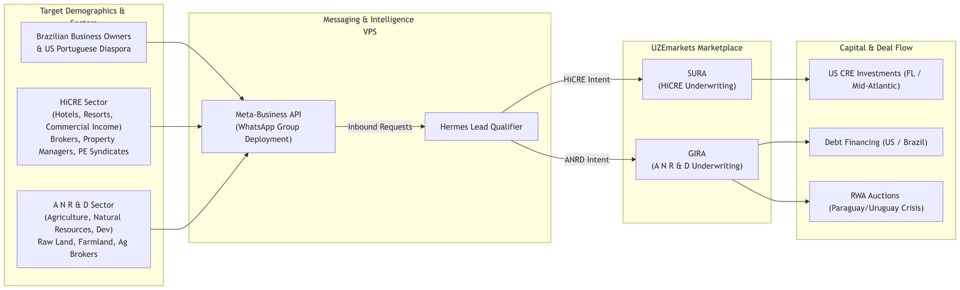
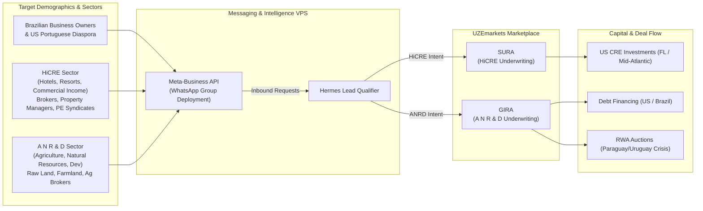

# Diagram 09 — WhatsApp Outreach & Americas Diaspora Flow

**Status: business/marketing flow per DeepSeek's MIV/WhatsApp directive
(relayed by James, 2026-11-09); this version (v2, supplied by James
2026-11-09) replaces the first version filed the same day — targets are
now segmented by population AND sector. Strategy diagram — the funnel it
draws is the Sprint 2+ build target, not a live channel. Technical
counterpart: Diagram 08. Channel policy note: outbound WhatsApp use
remains governed by the comms rules on file (warm engagement; James's
gates) until James revises them.**

**Reading the diagram.** Three target segments enter through the
Meta-Business API on the Messaging & Intelligence VPS: the Brazilian
business-owner population together with the US Portuguese diaspora; the
HiCRE sector itself (hotels, resorts, commercial income — brokers,
property managers, PE syndicates); and the A·N·R·D sector (raw land,
farmland, ag brokers). Hermes qualifies each inbound request and routes
by intent — HiCRE to SURA, A·N·R·D to GIRA. Outputs land as capital and
deal flow: US CRE investment in Florida and the Mid-Atlantic from SURA;
debt financing (US / Brazil) and RWA auctions in the Paraguay/Uruguay
crisis corridor from GIRA.
