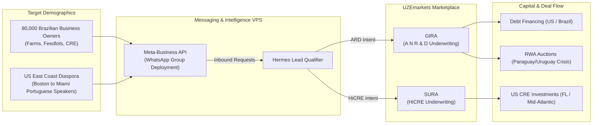

# Diagram 09 — WhatsApp Outreach & Americas Diaspora Flow

**Status: business/marketing flow per DeepSeek's MIV/WhatsApp directive
(relayed by James, 2026-11-09). Strategy diagram — the funnel it draws is
the Sprint 2+ build target, not a live channel. Technical counterpart:
Diagram 08. Channel policy note: outbound WhatsApp use remains governed
by the comms rules on file (warm engagement; James's gates) until James
revises them.**

**Reading the diagram.** The funnel starts from two populations: the
80,000-member Brazilian business-owner network (farms, feedlots, CRE) and
the Portuguese-speaking diaspora along the US East Coast, Boston to
Miami. Both enter through the Meta-Business API on the MIV, where Hermes
qualifies the lead and formulates the intent — A·N·R·D to GIRA, HiCRE to
SURA. Underwriting outputs land as capital and deal flow: debt financing
in the US and Brazil, RWA auctions in the Paraguay/Uruguay crisis
corridor, and US CRE investment in Florida and the Mid-Atlantic.
