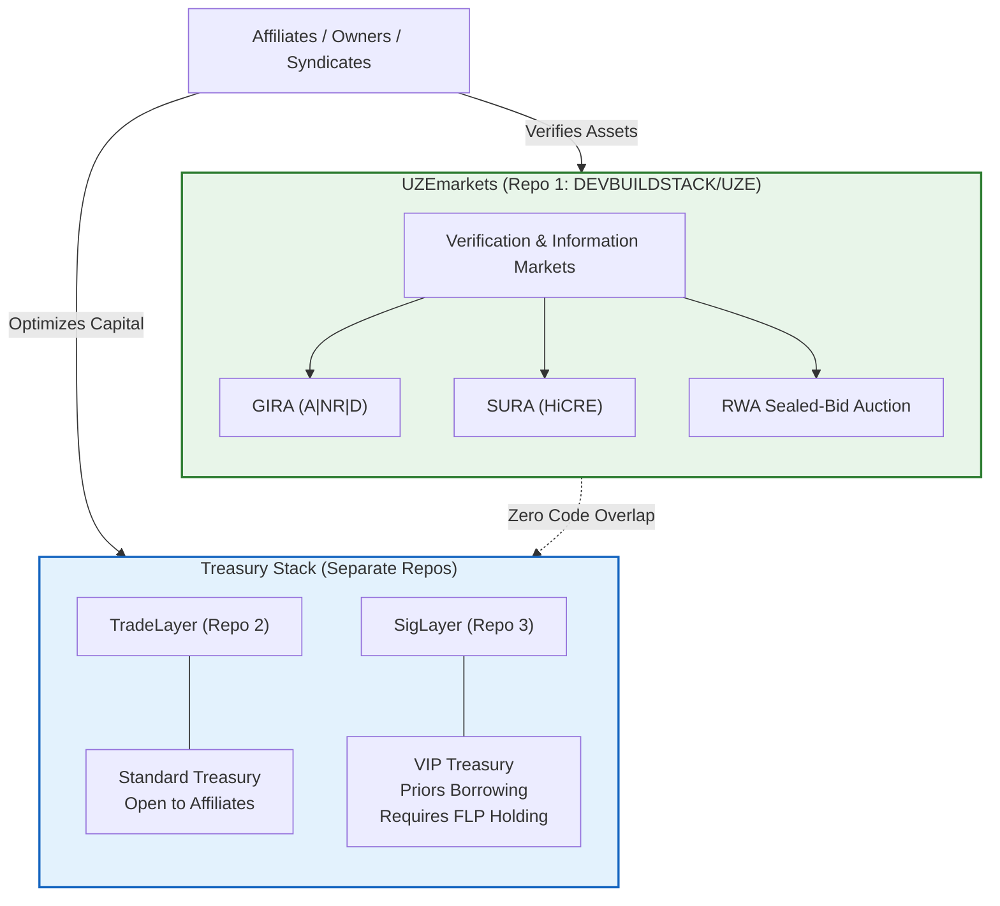

# Diagram 12 — Ecosystem Separation: The Three Repositories

The three-repo architecture (Final Architecture directive,
2026-11-10): UZEmarkets the Truth & Verification Layer; TradeLayer
and SigLayer the separate Treasury Stack. Zero code overlap.

