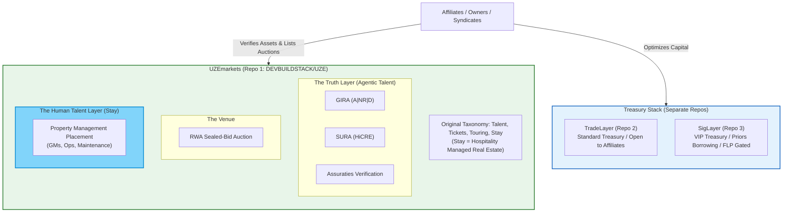

# Diagram 12 — Ecosystem Separation: The Three Repositories

The three-repo architecture, revised 2026-11-10 (Final Doctrine
directive): UZEmarkets as the Dual-Sided Talent Marketplace under
the original taxonomy — Talent, Tickets, Touring, Stay (Stay =
hospitality managed real estate) — with the Truth Layer (agentic
talent), the Venue (auctions), and the Human Talent Layer.
TradeLayer and SigLayer remain the separate Treasury Stack.

