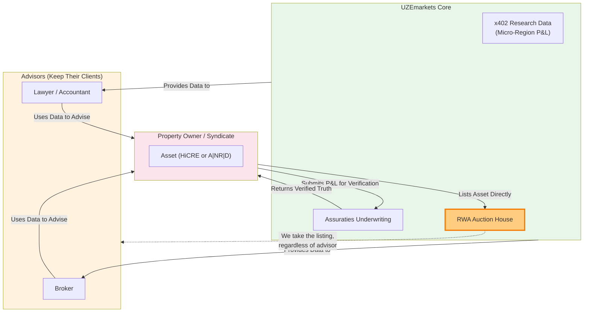

# Diagram 13 — The Non-Compete Flywheel & Auction Carve-out

The Non-Competition Doctrine (Final Architecture directive,
2026-11-10): advisors keep their clients and work from UZEmarkets
data; owners verify P&L through Assuraties; and the carve-out —
owners list assets directly with the RWA auction house, regardless
of advisor.

