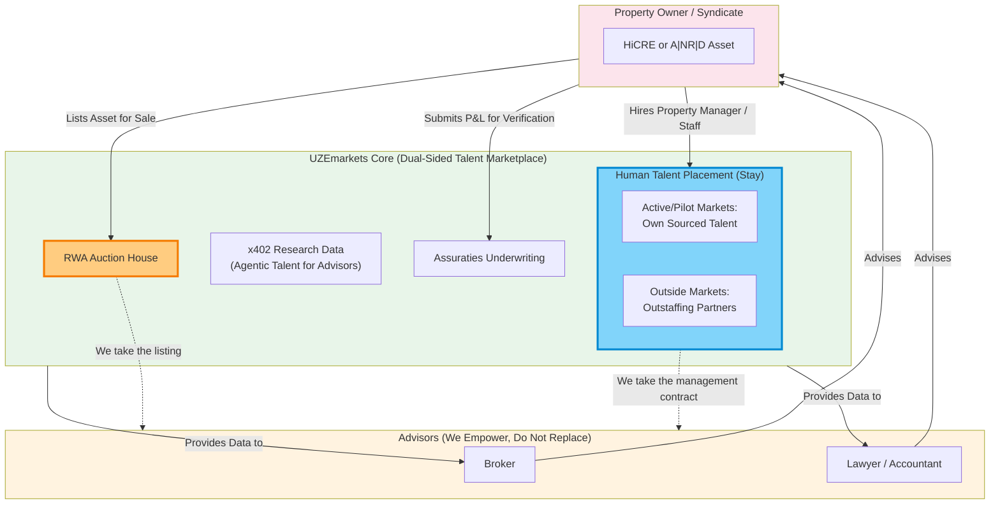

# Diagram 13 — The Finalized Covenant & Flywheel

The Non-Competition Covenant, finalized 2026-11-10 (Final Doctrine
directive): advisors are empowered, never replaced — UZEmarkets
takes no advisory clients. Two carve-outs where UZEmarkets DOES
take the business: auction listings, and property management &
operations placement (the human talent layer).

