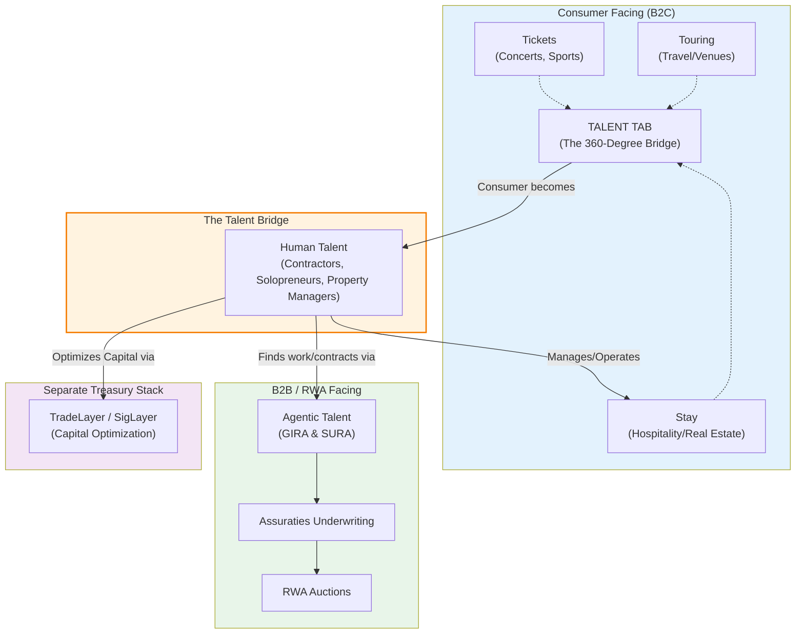

# Diagram 14 — The 360-Degree Talent Crossover

The crossover architecture (directive, 2026-11-10): "Talent" is
the linchpin of the original taxonomy. On the consumer side
(Tickets, Touring, Stay), the Talent tab is the bridge that turns
a consumer — the contractor, solopreneur, or property manager who
bought the ticket or booked the stay — into placed human talent.
On the B2B side, the Agentic Talent (GIRA & SURA) is the
equivalent: the financial analysts who underwrite the RWAs. The
Treasury Stack remains entirely separate.

