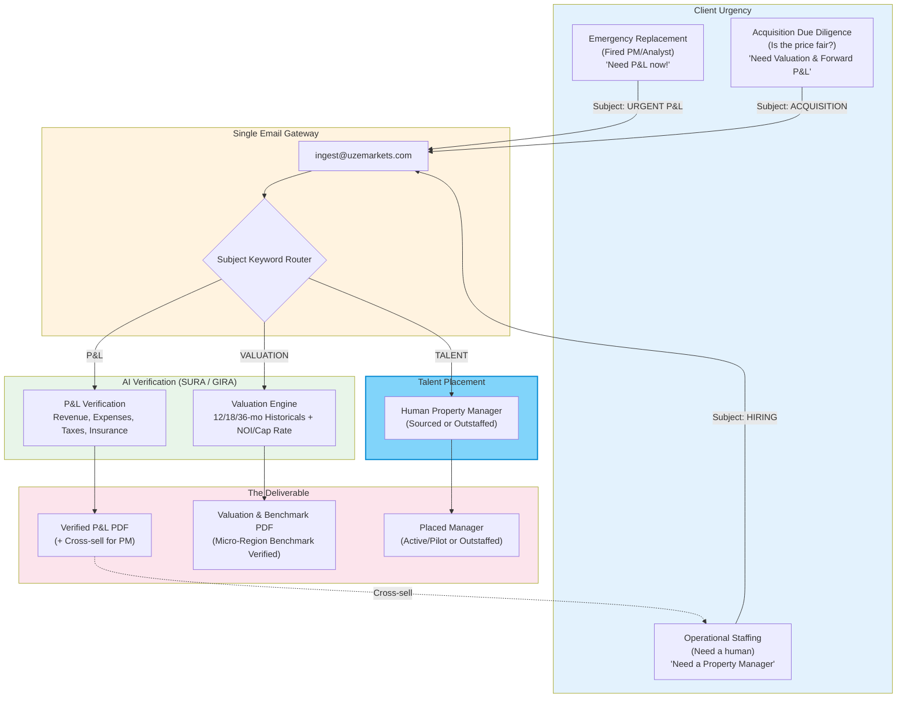

# 16 — Three Use Cases: One Email Gateway

How the single email gateway handles three completely different
client emergencies: emergency replacement, acquisition due
diligence, and operational staffing.

