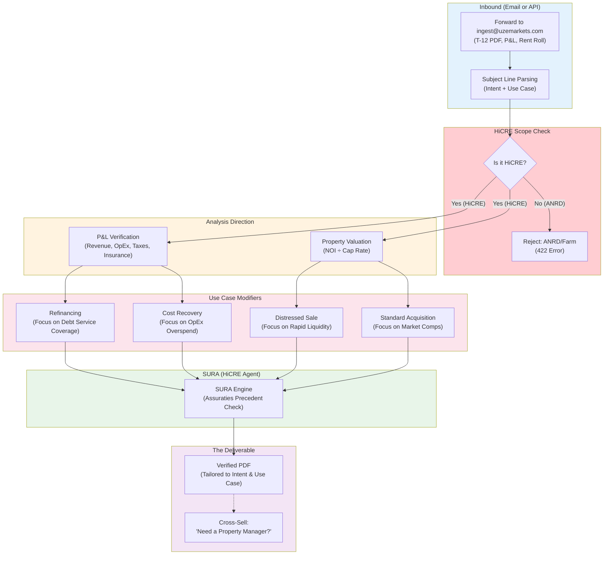

# 17 — UZE Underwriting Gateway: HiCRE-Only, User-Directed Logic

The email ingestion architecture: HiCRE scope check, then the
user's intent (P&L vs Valuation) and use case (Refinancing,
Distressed Sale, Standard Acquisition, Cost Recovery) direct
SURA's analysis. Expected to evolve as use cases are added.

