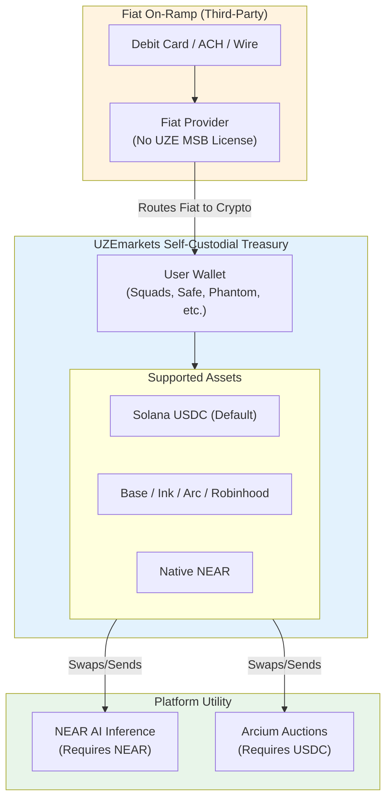

# Diagram 33 — Business Treasury Flow (Fiat & Treasury)

Filed 2026-11-11 with the Autonomous Treasury build (owner's
override). Sourcing annotations per research note 18:

- **Fiat on-ramp session:** the integration pattern is Fundio's
  CDP onramp session route (`src/app/api/session/route.ts` —
  JWT-minted session token, third-party provider, funds land
  directly in the user's self-custodial wallet; UZEmarkets
  never touches fiat).
- **Swaps / x402 payments:** CDP is the target integration
  (AgentKit = Sprint 2 build item; Fundio contains no AgentKit
  and no swap module — verified 2026-11-11). Hackathon state:
  mock CDP router in compose (`treasury.py` / `treasury_router.py`).
- **Cross-chain USDC:** production moves ride Circle CCTP —
  **V2 only; V1 contracts pause December 1, 2026** (note 18,
  Part 4). No CCTP code exists in the UZE stack today.
- **x401 identity:** Proof's open protocol (draft 0.2.0);
  verification is issuer-key verification over HTTP. Arc is a
  supported network on the settlement side of the x401/x402
  flow. Real x401 verification is pending research/build —
  see diagram 34 and note 18.

