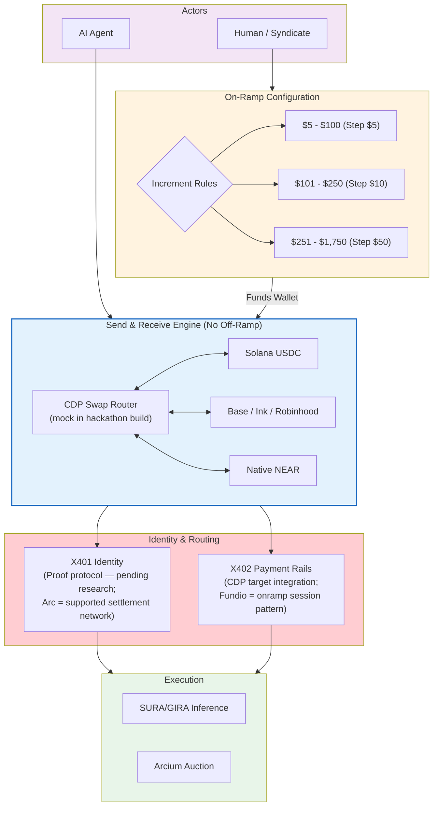

# Diagram 34 — Agentic & Human Configuration (Send/Receive & X401)

Filed 2026-11-11 with the Autonomous Treasury build (owner's
override). The distinction this diagram carries (directive,
2026-11-11; verified state per research note 18):

- **x402 Payments / Swaps — CDP (target integration).** The
  hackathon build runs the mock x402 tariff + a mock CDP swap
  router. Fundio's reusable contribution is its CDP **onramp
  session** pattern only — Fundio has no embedded AgentKit and
  no swap module (code-read, 2026-11-11). AgentKit integration
  is a Sprint 2 build item.
- **x401 Identity — PENDING RESEARCH.** x401 is Proof's open
  identity protocol (draft 0.2.0): the server challenges with a
  verifiable-credential request (HTTP 401), the agent presents
  a selectively-disclosed credential + a transaction-bound
  signed approval, and the backend verifies against the
  issuer's published keys before the x402 transaction proceeds.
  Arc is a supported network on the settlement side of that
  flow. Research is filed (note 18, Parts 2–3); no x401 build
  until James directs it.

