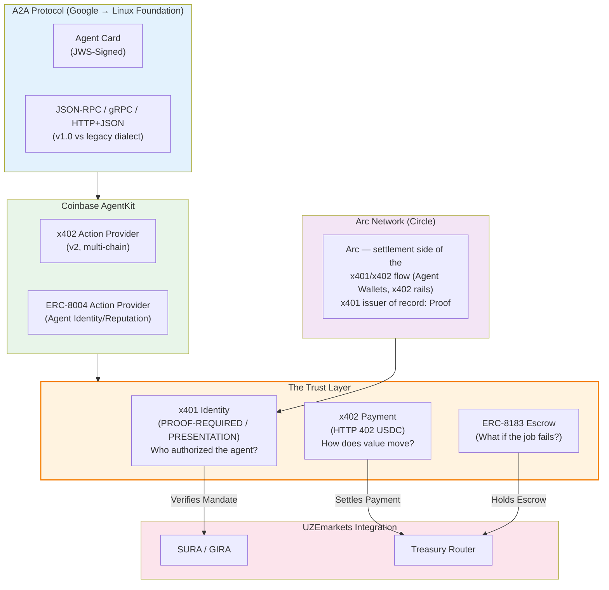

# Diagram 35 — The Agent Trust Stack

Filed 2026-11-11 with the AgentKit & A2A compliance audit
(research note 35). Two annotations against the verified record:

- **x401's issuer of record is Proof** (the protocol's
  publisher; NIST IAL2-anchored credentials, WebTrust-audited
  CA). The "Arc x401 Issuer" framing in the originating
  directive is not what the public record shows: Arc is
  Circle's L1 and sits on the **settlement side** of the
  combined x401/x402 flow (Circle Agent Wallets, x402 rails).
  The diagram below labels the Arc box accordingly; research
  note 18 Parts 2–3 and note 35 §3 carry the full finding.
- **ERC-8004** appears twice in the current stack map by
  design: as an AgentKit action-provider family (relayed) and
  as the identity registry XSigLayer is already specified
  against in the SigLayer statement of record.

