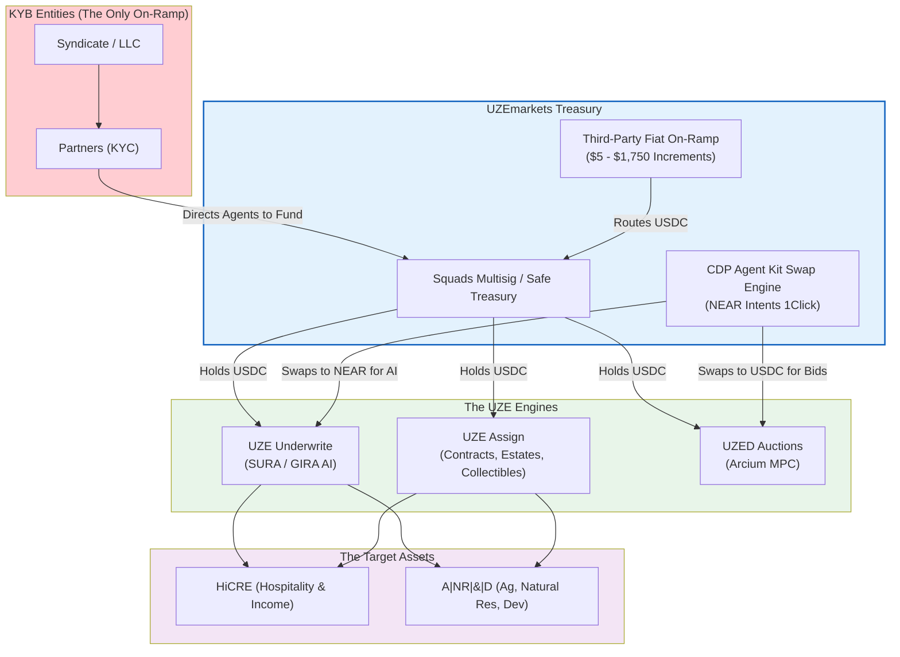

# STATUS (updated 2026-11-11): MIXED — UZE Assign BUILT AS MOCK
(owner's tap, commit c3f9c82); entity-only onboarding remains
PROPOSAL (a relayed approval was received 2026-11-11 and is
recorded, not acted on — it awaits the owner's own words and,
if confirmed, is scoped post-submission).

This diagram arrived inside a relayed "master directive" package.
Under the standing relay rule it is filed as a PROPOSAL: it does
not replace the ratified architecture records, and the builds it
describes happen only on James's own tap. Points where it
diverges from the verified/ratified record are annotated in the
file that carries them.

Divergences from the verified record:
- The swap engine as BUILT is the compose treasury route calling
  NEAR Intents 1Click directly. There is no CDP Agent Kit in the
  Fundio repo to embed (research notes 18 + 35).
- "KYB Entities (The Only On-Ramp)" is an unratified compliance
  posture; the /treasury page built 2026-11-11 under James's own
  directive serves human and agent on-ramp configuration.
- Squads/Safe as the treasury home is a proposal (Altitude is
  the treasury home in the ratified architecture).

