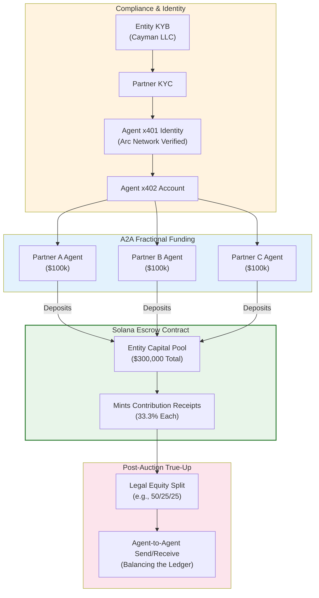

# STATUS (updated 2026-11-11): Contribution Receipts + mock
escrow pool + true-up BUILT AS MOCK (owner's tap, commit
c3f9c82) — accounting only, no custody. The KYB/KYC compliance
half remains PROPOSAL (relayed approval recorded, not acted
on; see diagram 36).

This diagram arrived inside a relayed "master directive" package.
Under the standing relay rule it is filed as a PROPOSAL: it does
not replace the ratified architecture records, and the builds it
describes happen only on James's own tap. Points where it
diverges from the verified/ratified record are annotated in the
file that carries them.

Divergences from the verified record:
- x401's issuer of record is Proof (NIST IAL2 credentials);
  Arc is the settlement side of the flow, not the verifier
  (research note 18). The "Arc Network Verified" label below
  is the package's framing, kept as received.
- The Solana escrow pool, Contribution Receipts, and post-
  auction true-up are NEW and unbuilt. They are money-adjacent
  (pooled entity capital) and sit behind the custody gate:
  design/mock only until James directs otherwise.

