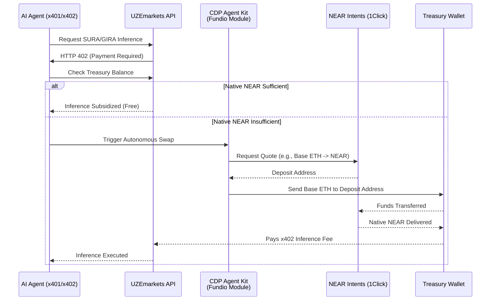

# STATUS (updated 2026-11-11): BUILT — treasury_router +
direct 1Click swap route, live quote verified, commit 445f996.
The two divergence notes below stand (no Fundio AgentKit
participant exists; no free-inference branch).

This diagram arrived inside a relayed "master directive" package.
Under the standing relay rule it is filed as a PROPOSAL: it does
not replace the ratified architecture records, and the builds it
describes happen only on James's own tap. Points where it
diverges from the verified/ratified record are annotated in the
file that carries them.

Divergences from the verified record:
- There is no "CDP Agent Kit (Fundio Module)" participant in
  the built system: the flow as built is Agent -> UZE API
  (treasury_router pre-task check) -> NEAR Intents 1Click
  quote -> wallet sends the deposit. Diagram kept as received.
- The "Inference Subsidized (Free)" branch is not in the built
  design: a sufficient NEAR balance skips the SWAP, not the
  x402 metering.

