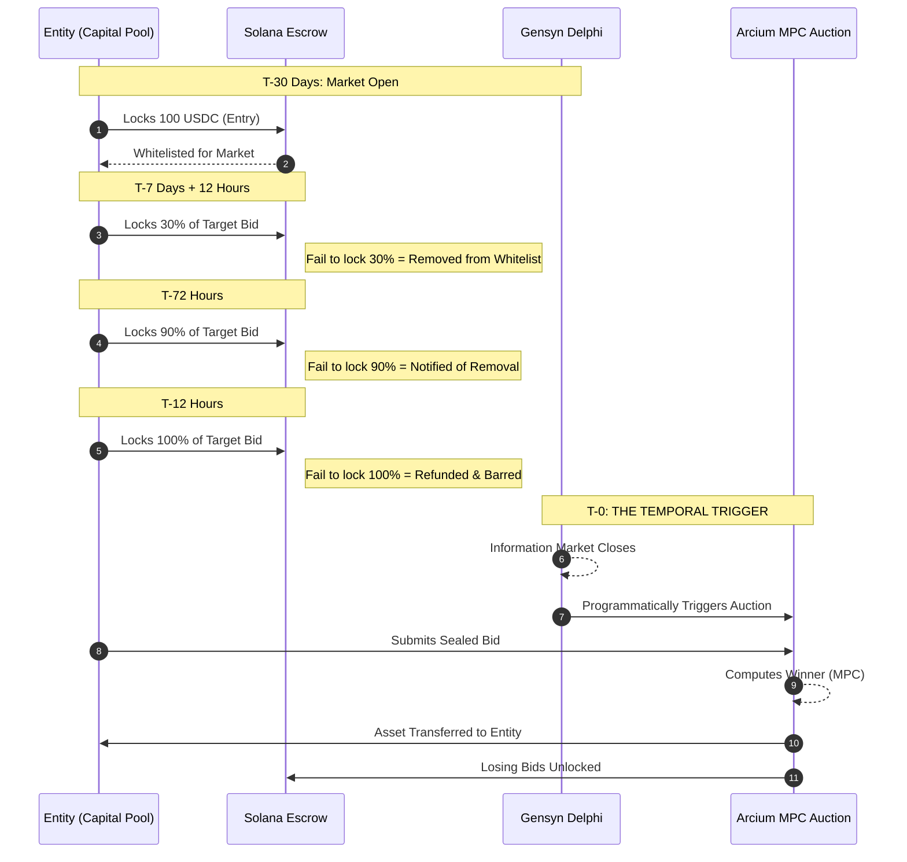

# PROPOSAL — relayed architecture package, 2026-11-11 (not ratified)

This diagram arrived inside a relayed "master directive" package.
Under the standing relay rule it is filed as a PROPOSAL: it does
not replace the ratified architecture records, and the builds it
describes happen only on James's own tap. Points where it
diverges from the verified/ratified record are annotated in the
file that carries them.

Divergences from the verified record:
- A Delphi market close PROGRAMMATICALLY triggering an Arcium
  auction contradicts the ratified evidence-gated rule (Nov 8):
  no auction auto-executes; a human gate stands in front of
  execution. Delphi itself is a grant-stage proposal (no
  application sent; open-source commitment unconfirmed).
- The Commitment Ladder (100 USDC / 30% / 90% / 100%) is a new
  proposal; no escrow ladder exists in the built system.

