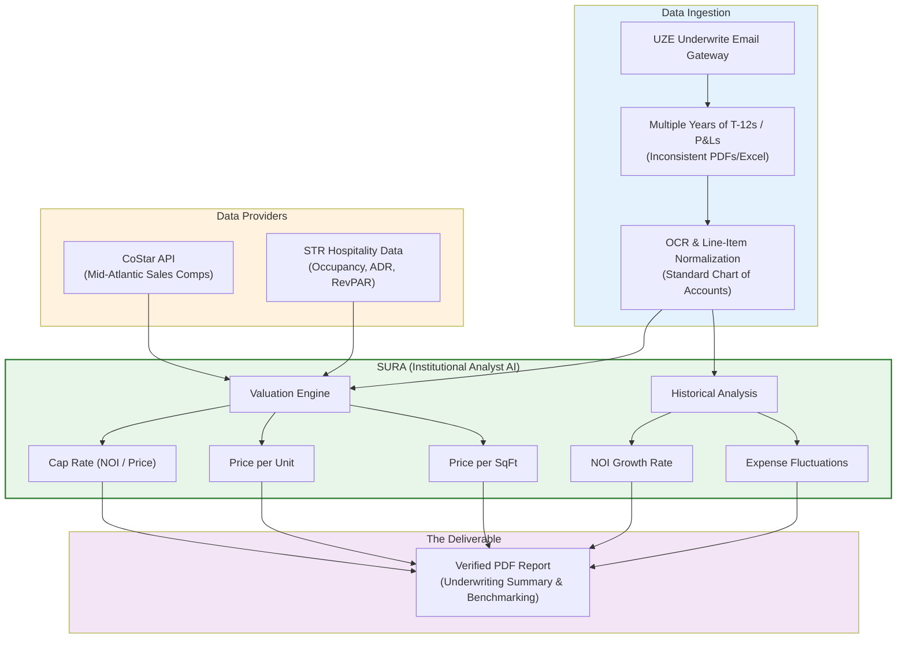

# Diagram 41 — The Institutional Underwrite Flow

PROPOSAL — relayed directive, 2026-11-11 (not ratified).
Scoping notes against the verified record (SoSem, 2026-11-11):

- The email gateway ALREADY computes cap rate + implied value
  for the Acquisition/Valuation use case, with 12/18/36-month
  historicals (built 2026-11-10). Price per Unit and Price per
  SqFt are the genuinely new metrics here.
- The chart-of-accounts normalization, if built, maps INTO the
  ratified seven-bucket P&L taxonomy (James, 2026-11-10; Spec
  07 §2.2): Revenue / Operating Expenses / Taxes / Insurance(s)
  / Interest / Misc Net / Profit — OpEx never absorbs Taxes,
  Insurance, or Interest.
- SURA's underwriting analysis lives in agents.py +
  email_gateway.py. juror.py is the Assuraties claim-judging
  prompt (already taxonomy-updated 2026-11-10); the directive's
  "update juror.py" targets the wrong file.
- CoStar/STR: no license, no integration exists. An adapter
  would ship as an evidence-gated MOCK with synthetic data
  labelled synthetic — never presented as CoStar data.

