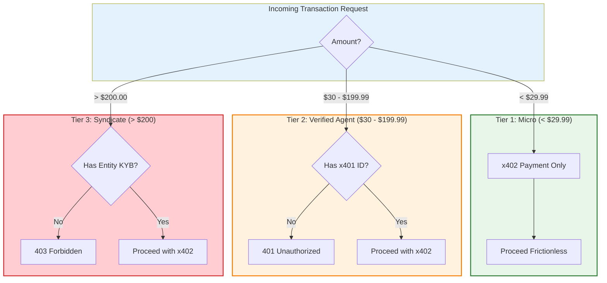

# Diagram 49 — Three-Tier x401/x402 Compliance — PROPOSAL

STATUS: PROPOSAL (consolidated relay version, 2026-11-11
~19:17 ET; supersedes the ~19:12 relay text). Directive 1's
compliance family remains unconfirmed by the owner in his
own words; nothing here is implemented. Enforcement point
when built: metering.py's identity seam — the consolidated
version now agrees.
FIXED by this version: the cent boundaries are exact
($29.999 Tier 1 / $30.00 Tier 2 / $199.99 Tier 2 / $200.00
Tier 3).
FAILED PREMISE in this version: Tier 2's rule that x401
verification "must route through Circle and Arc." Per
research note 18 (verified 2026-11-11 against the primary
source), x401 is Proof's protocol (proof.com/x401) and Arc
is Circle's settlement L1 — Arc issues no credentials and
routes no identity verification. The submission copy in
this package repeats the claim ("routed through
Circle/Arc") and cannot ship as written; identity
verification routes through the x401 issuer/verifier, and
Arc's role stays settlement-side.

