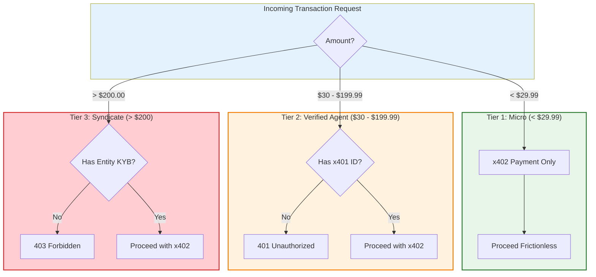

# Diagram 49 — Three-Tier x401/x402 Compliance — PROPOSAL

STATUS: PROPOSAL (relayed 2026-11-11 ~19:12 ET). The tier
thresholds refine Directive 1's compliance posture, which
remains unconfirmed by the owner in his own words; nothing
here is implemented. Enforcement point when built:
metering.py's identity seam (treasury_router.py is the
pre-task NEAR compute check, not a transaction validator).
Boundary defect noted for the build: Tier 1 "under $29.99"
and Tier 2 "$30.00–$199.99" leave $29.99 itself claimed by
the pseudo-logic's `29.99 <= amount` Tier-2 branch while the
tier text starts Tier 2 at $30.00 — settle the exact cent
boundaries at build time.

