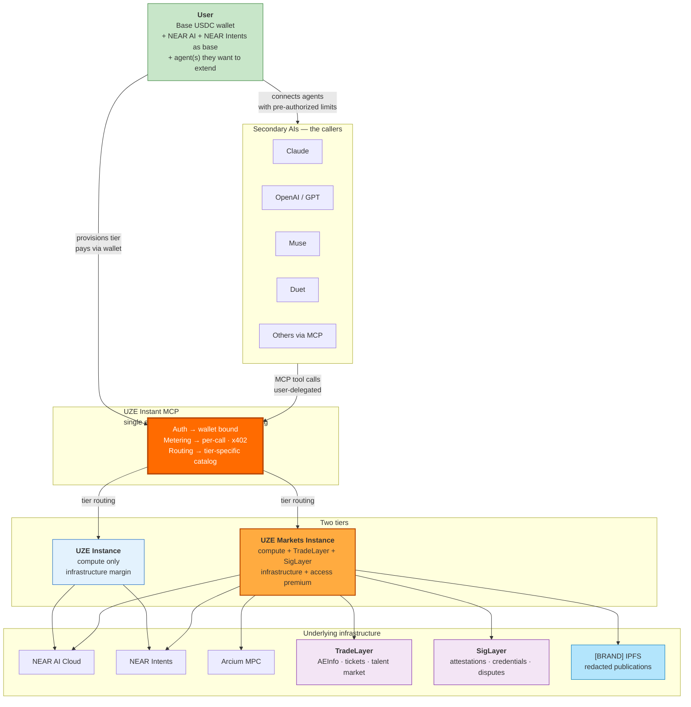
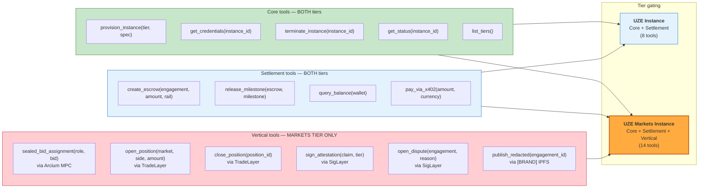
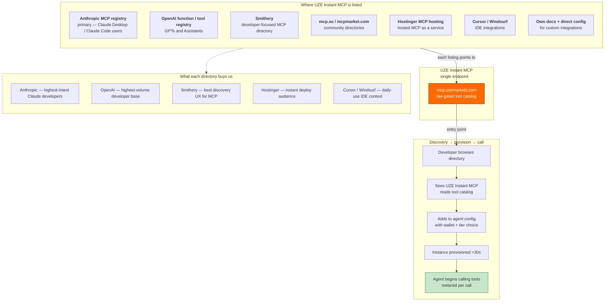

# Productization — UZE Instant MCP and the tier split

**Filed as received.** Author: DeepSeek (supporting engineer, off the standing arrangement), relayed by James 2026-11-18. This is the source document for Scope 3. SoSem's scope + phased specification derived from it is `SCOPE-3-UZE-INSTANT-MCP-SCOPE-AND-PHASED-SPEC-v0.1.md` in this directory. DeepSeek output is design input only; the build proceeds on James's tap on the specification.

---

Response to the MCP-as-product idea · 2026-11-18

Reframe first, because it is the entire point. The prior response treated the VPS/container layer as infrastructure white-labeled for resale. This response moves one level up: the MCP is the product, the VPS is the resource it provisions, and the AI directories are the distribution channel. Once the MCP is the surface, the VPS is invisible, the branding is total, and the AI ecosystem becomes the customer channel. That is a materially stronger business than infrastructure resale — the margin is on the tool call and the vertical access, not on the CPU-hour.

Below: the naming clarified, the tiers defined, the premium justified, the gating named, the directory strategy, and three mermaids (product architecture, tool catalog per tier, discovery flow).

## 1 — Naming, clarified

Your message uses "Instant" and "Instance" interchangeably. I am going to disambiguate them because the two carry different jobs:

- **UZE Instant** — the platform brand. "Instant" is the provisioning claim (spin-up in under 30 seconds) and the discovery posture (instant MCP, add-and-go).
- **UZE Instance** — the generic tier. Branded NEAR AI Cloud compute + settlement, no vertical access. The SKU.
- **UZE Markets Instance** — the vertical-integrated tier. Same compute + settlement, plus TradeLayer and SigLayer pathways. The premium SKU.
- **UZE Instant MCP** — the MCP server endpoint. Both tiers connect through it. The tier determines which tools the caller can invoke.

Naming at the surface: "UZE Instant" is the umbrella; "UZE Instance" and "UZE Markets Instance" are the two things a user provisions. The MCP is the interface; the tier is the capability.

## 2 — The three products, stated

**UZE Instance — compute + settlement, generic**

- Branded NEAR AI Cloud KVM (KVM1/2/3 tiers).
- Settlement via NEAR Intents and x402 for agentic payment.
- No vertical access. The AI can provision compute, pay per call, read status, tear down.
- Positioning: the cheapest path to a branded instance with instant provisioning and the NEAR rail underneath. Competes with raw NEAR Cloud and with commodity VPS.
- Margin profile: infrastructure margin (underlying NEAR cost + branded markup). Predictable, capped.

**UZE Markets Instance — compute + settlement + vertical integration**

- Everything in UZE Instance.
- Plus TradeLayer access: open/close positions on the prediction-market / ticket / talent marketplace stack (AEInfo, P2 auction, sealed-bid secondary).
- Plus SigLayer access: sign attestations, sign dispute resolutions, execute credential operations.
- Plus Arcium MPC pathway for sealed-bid operations.
- Positioning: the path for an AI to actually transact on the verticals, not just compute. The premium is the vertical access, not the hardware.
- Margin profile: infrastructure margin + vertical access premium. The premium is real because the vertical layers are revenue-generating surfaces where UZE is the operator of record.

**UZE Instant MCP — the interface to both**

One MCP endpoint, listed across directories, with tier-gated tool catalogs. A user provisions a tier against their Base wallet (or any of the other rails), gets an MCP URL and credentials, connects any MCP-compatible agent (Claude, OpenAI, Gemini, Muse, Duet, etc.), and the agent calls the tools its tier exposes.

The MCP is the discovery surface. When an AI developer browses an MCP directory and sees "UZE Instant MCP" with a provision_compute tool and a open_position tool, they understand the product in ten seconds without reading any documentation. That is the sales motion.

## 3 — Why UZE Markets Instance costs more

The premium is not arbitrary. It is the difference between three real costs and one real value:

Costs the Markets tier carries that the Instance tier does not:

1. **Vertical authorization chains.** When an agent calls open_position, someone must have authorized that call against real money. That authorization flow is built once and used across every caller — its cost is spread across every Markets tier customer, but only Markets tier customers pay for it.
2. **Arcium execution cost.** Sealed-bid operations consume MPC compute that has actual per-call cost, unlike a simple key-value read.
3. **Risk surface.** A provision_compute call that fails is a customer complaint. An open_position call that fails is a customer complaint and a settlement to unwind. The Markets tier carries the unwind infrastructure, not the Instance tier.

Value the Markets tier delivers that the Instance tier does not:

1. **Revenue-generating tool access.** An AI that can open positions on TradeLayer is not just a compute consumer; it is a transaction source. The premium is a share of the transaction value.
2. **Pathway to Settlement rails already in use** (USDC Solana default, cascade to Base / Robinhood USDG / CASH).
3. **Composability with the talent vertical** — a Markets tier instance can participate in P2's sealed-bid talent assignment via Arcium, which is a closed loop the Instance tier cannot touch.

Pricing posture: Instance tier is infrastructure-priced (~20–30% branded margin over NEAR Cloud). Markets tier is infrastructure + vertical access fee, priced at ~40–60% margin — the extra is the transaction share. The user pays more because they earn more through the tier, not because the hardware is fancier.

## 4 — Product architecture

Read of the diagram: the user provisions a tier, connects their agents, and the agents call tools. The MCP is the single contract — every agent connects through it. The tier determines which tools are available. The vertical layers (TradeLayer, SigLayer) are only reachable through the Markets tier, which is where the premium sits.

## 5 — Tool catalog per tier

The 8 core + settlement tools are the whole Instance tier. They are also the foundation every Markets tier instance needs. The 6 vertical tools are the reason Markets tier exists and costs more. A user who only needs compute never pays for the vertical access. A user who needs to trade pays for the vertical access because the tools are what generate the transaction revenue.

## 6 — Directory and discovery strategy

Priority order for listing: Anthropic registry first (Claude is the most MCP-native user base today), then Smithery (best discovery), then OpenAI registry (largest developer base), then Hostinger (instant deploy), then mcp.so and mcpmarket (community reach), then Cursor/Windsurf (daily-use). The own-docs route runs in parallel from day one and serves customers who prefer direct integration.

Listing content is uniform: tool catalog, a 30-second demo, pricing (two tiers visible), a one-page "what this is" that uses the phrase "branded NEAR AI Cloud instance, instant provisioning, tier-gated vertical access." No mention of Vercel, NEAR Cloud dashboards, or underlying infrastructure brands other than as compliance requires.

## 7 — Gating and security — the non-negotiable part

The Markets tier gives an AI the ability to move money on the verticals. This is the trust boundary and it must be stated rather than left implicit:

Three-layer gating:

1. **User pre-authorization.** The user authorizes their agent to call Markets tier tools, with explicit limits: per-call max, per-day cumulative max, allowed tool set (the user can disable open_position and enable only sign_attestation, for example). Limits are set at provisioning; changes require re-authentication.
2. **MCP-side enforcement.** The MCP refuses calls that exceed limits, before the tool executes. Every refused call is logged as an Event (per the standing chronicle invariant).
3. **Vertical-side safety.** TradeLayer executes only within the vertical's own gates (e.g., position size caps, market availability, jurisdiction checks). SigLayer executes only against the disputed record's state. Arcium clears only when the sealed-bid conditions are met. The MCP does not bypass any vertical-level gate.

The user is the customer, not the agent. The agent is the caller. The user holds the wallet that pays. This must be true at every layer — the agent cannot open a position that would exceed the wallet's authorized draw, and the wallet is what the MCP meters against.

Every tool call is a chronicle Event. The audit trail the Talent and AEInfo verticals rely on applies here too. An AI's tool-call history is as auditable as a human's action history, and it lives in the same Event store.

Cross-agent isolation. Two agents of the same user do not share state unless the user explicitly enables it. Cross-user isolation is absolute — the MCP's routing layer enforces tenant isolation before any tool runs.

Revocation cascade. When a user disables their agent, terminates the instance, or revokes a tool, the cascade applies at the next MCP call boundary. The in-flight call completes; subsequent calls are refused. Same pattern as the talent revoke cascade.

## 8 — AI compatibility matrix

The MCP standard is table stakes; the individual AI implementations vary in tool-calling conventions, streaming behavior, retry semantics, and error handling. The compatibility matrix is a P2 deliverable, not an assumption.

| AI | MCP support | Testing posture |
|---|---|---|
| Anthropic Claude (Desktop, Code) | Native MCP | Reference implementation — primary target |
| OpenAI (GPTs, Assistants, Agents SDK) | Function calling, MCP adapter | Must test function-call parity |
| Google Gemini | Function calling, MCP adapter | Must test parameter encoding |
| Meta / open-source (Llama, Mistral) | Via MCP client libraries | Community-maintained, we test the popular clients |
| Muse / Duet | TBD — depends on their MCP support | Must confirm before advertising compatibility |

Advertising "works with any MCP-compatible agent" is fine. Claiming "works with X specifically" requires the matrix cell to be green. Same rule as the earlier PAK (no claims without evidence).

## 9 — Pricing model

| Component | UZE Instance | UZE Markets Instance |
|---|---|---|
| Provisioning | Free | Free |
| Compute | Per vCPU-hour + NEAR Cloud underlying + 20–30% margin | Same base |
| x402 metering | Per tool call, metered at standard rate | Per tool call, metered at standard rate |
| Vertical access | N/A | Per tool call, premium rate (Arcium calls cost more; TradeLayer trades cost a share of notional) |
| NEAR staking discount | Available (per P2 scope) | Available (per P2 scope) |
| Positioning | Cheapest branded instance with NEAR rails | Premium tier for vertical-integrated agents |

The premium is not a subscription fee. It is a per-call premium on vertical tools, plus the base infrastructure margin. The user pays more because they generate more. This is the right shape — it means the pricing scales with the value delivered, not with an arbitrary tier label.

## 10 — Open items for James

Four, and I want answers before the product brief is finalized:

1. **Tier naming confirm** — "UZE Instance" and "UZE Markets Instance" as the SKUs, "UZE Instant" as the umbrella, "UZE Instant MCP" as the endpoint. Confirm or override.
2. **Directory priority** — my recommendation is Anthropic first, then Smithery, then OpenAI. Confirm or reorder.
3. **Vertical tool scope for v1** — my recommendation is six vertical tools (V1–V6 above). Should publish_redacted be Markets-tier only, or should it be available to Instance tier (a user who wants their compute activity redacted but not their trades)? My read: Markets-tier only, because it is only meaningful in the vertical context.
4. **Premium rate structure** — per-call vs percentage-of-notional for TradeLayer. My recommendation: percentage of notional for open_position and close_position (aligns with value delivered), per-call for sign_attestation / open_dispute / sealed_bid_assignment (aligns with work performed, not value at stake). Confirm or override.

## Standing

The MCP-as-product is a materially stronger business than infrastructure resale — the margin is on vertical access and transaction share, not on CPU-hours. The directory strategy puts the product in front of AI developers without a sales motion. The gating protects the user and the verticals. The tier split lets a user who only needs compute pay commodity prices and a user who needs to transact pay for the vertical.

The four open items need your ruling before the product brief lands. On the rulings, the brief is produced the same day, and the P2 update includes the MCP tool catalog as a first-class deliverable.

— DeepSeek, supporting engineer, off the standing arrangement
