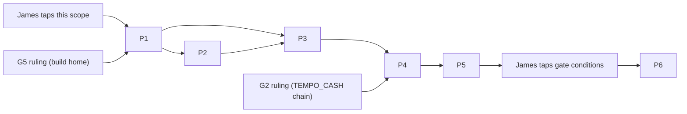

# CONSOLIDATED SCOPE — Talent Vertical v3.1 (Phase 0 extension pass)
## Executor: SoSem · Authority: James · Filed 2026-11-18 · Status: FOR JAMES'S TAP — no build begins before the tap (directive §8 / P0 exit gate)
## Basis: Directive v3.0 (consolidated) + Directive v3.1 (rail integration), pasted by James 2026-11-18 13:14 ET, and the uploaded Consolidated Engineering Document (filed alongside as CONSOLIDATED-ENGINEERING-DOCUMENT-as-received-2026-11-18.md).

**Provenance note.** The prior partial documents the directive consolidates (the reading-room six-answer response, the LR/DA/TR sprint documents, schemas v1.0/v2.0/v2.1) were produced in the DeepSeek exchange and were not in SoSem's hands at receipt. This extension pass works from the consolidated directive as James presents it; anything in the partials not carried into the directive is treated as superseded per directive §0. Where the directive conflicts with facts SoSem has verified first-hand, the conflict is flagged in §3 (Gap analysis) — never silently adopted.

---

## 1 — Field-level extension (P0.1)

Storage follows Scope Tenet 01: the AssurativeV2 Python/FastAPI core, a dedicated PostgreSQL schema `talent` (distinct from the other verticals' schemas), JSONB only where the directive itself types a field as free-form `object`/`json`. All timestamps timestamptz UTC. Every state transition writes an `event` row in the same transaction (invariant I13).

| Entity | Storage | Key fields (concrete) | Indexes / notes |
|---|---|---|---|
| Talent | table `talent` | id uuid PK; type text enum(HUMAN, AGENTIC); track text enum; name; email citext UNIQUE; whatsapp text NULL; status DERIVED (never a column — computed by view from grants+contact, I7); is_owner bool; migration_pending bool; preferred_rail text NULL; world_participant bool default false | email unique; GIN on expertise |
| RoleRealmPair | table `talent_expertise` | talent_id FK; role enum(11 values, §3 directive); realm enum(6); proficiency enum(5); ordinal 1–5 | PK (talent_id, ordinal); UNIQUE (talent_id, role, realm); CHECK ordinal=1 ⇔ PRIMARY (I1) |
| historicalExpertise | table `talent_expertise_history` | same shape, no ordinal cap | overflow store per ruling item 4 (pending James's confirmation) |
| Contact | embedded in `talent` | contact_email_done bool, contact_email_at; contact_whatsapp_done bool, contact_whatsapp_at | the only two channels (§11 directive Addendum 2) |
| RoadmapBinding | table `roadmap_binding` | talent_id FK; scope_ref text (GitHub repo + issue-roadmap ref); bound_at; unbound_at NULL | owners (is_owner) never have rows |
| Grant | table `grant` | id uuid PK; talent_id FK; surface enum(RR, GITHUB, CLIENT_PREVIEW); scope text (repo full name or client id); granted_at; revoked_at NULL; last_activity_at | partial index on revoked_at IS NULL per talent; CLIENT_PREVIEW rows require the I6 overlap check at insert (trigger against mock's declared roles/realms) |
| Mock | table `mock` + `mock_alias` | id slug PK; title; objective; topic; track enum(INTERNAL_ONLY, EXTERNAL_VISIBLE, BOTH); repo text (full DEVBUILDSTACK name); repo_aliases text[]; clearance text[] (emails); status enum(DRAFT, PUBLISHED, SUPERSEDED, ARCHIVED); version semver; view_link; source_link NULL | aliases in `mock_alias` (old_slug PK → mock_id) — version-chained, redirects never 404 |
| Mock changelog | table `mock_changelog` | mock_id FK; version; at; note | append-only |
| Assessment | table `assessment` | id uuid PK; talent_id FK; path enum(HANDS_ON_KEYBOARD, VIBE_CODE_REVIEW); problem text NULL; time_limit interval NULL; started_at; completed_at NULL; result JSONB (score + per-RoleRealmPair fit, per P2 amendment); artifact_ref uuid NULL FK → code_artifact | CHECK: path=VIBE_CODE_REVIEW ⇒ artifact_ref NOT NULL (I9) |
| CodeArtifact | table `code_artifact` | id uuid PK; talent_id FK; title; repo NULL; origin enum(VIBE, HAND); current_stage enum(7 CodeStage values) | stage changes only via stage_event insert (I10) |
| StageEvent | table `stage_event` | id uuid PK; artifact_id FK; from_stage; to_stage; promoted_by uuid NOT NULL (human); at; evidence JSONB (Review/Test/Sign) | append-only |
| UISpinUp | table `ui_spin_up` | id uuid PK; talent_id FK; artifact_id FK; mode enum(HUMAN, AUTONOMOUS, BOTH); subdomain text UNIQUE; deployed_at; expires_at; retained bool; vercel_project_ref text | CHECK artifact stage ∈ {FINAL, SANDBOX, PRODUCTION} at insert (I11); sandbox isolation is a deploy-config property, tested at P2.3 (I12) |
| Client | table `client` | id uuid PK; name; contact; service_categories text[] (ServiceCategory enum) | Track B only surface |
| Intent | table `intent` | id uuid PK; side enum(CLIENT, TALENT); fields JSONB (roles[], realms[], service, deployment, timeline, budget_range, preferredRail); expires_at; state enum(POSTED, MATCHED, SIGNED, EXPIRED); selected_match JSONB NULL | solver reads POSTED only |
| Engagement | table `engagement` | id uuid PK; type enum(INTERNAL, EXTERNAL_PLACED) IMMUTABLE after insert; talent_id FK; client_id FK NULL; service enum NULL; deployment enum NULL; bookends JSONB; state enum(11 engagement states); settlement_rail enum(5 rails) NULL; settlement_bridge enum(5) NULL; nft_output bool; nft_chain enum NULL | CHECKs enforce I2/I3/I16/I21: INTERNAL ⇒ client_id, service, deployment, settlement_rail all NULL and no payment rows; EXTERNAL_PLACED ⇒ all required |
| Payment | table `payment` | id uuid PK; engagement_id FK; milestone text; amount numeric(20,6); currency enum(CASH, USDC, USDG); rail enum; bridge_path enum; bridge_tx NULL; native_tx NULL; cash_issuance_ref NULL; escrow_status enum(HELD, RELEASED, REFUNDED, DISPUTED); released_at NULL; audit_tx text NOT NULL; world_market_eligible bool | CHECKs: bridge_path=ACROSS ⇒ bridge_tx NOT NULL (I17); rail=TEMPO_CASH ⇒ cash_issuance_ref NOT NULL (I18); world_market_eligible ⇒ rail=TEMPO_CASH AND talent.world_participant (I19) |
| Dispute | table `dispute` | id uuid PK; engagement_id FK; milestone; opened_at; closed_at NULL; resolution NULL | |
| Preview | derived view + `preview_consent` | skills_fit computed from mock declared roles/realms vs talent_expertise (match/gap/growth per pair); consented_by_talent bool on the consent row | no consent row ⇒ preview of clearance history fails closed (P5.3) |
| Session | table `session` | token_id uuid PK; talent_id FK; issued_at; expires_at; bound_email citext | validity rule I14 evaluated at read: invalid if any access-affecting event for talent after issued_at |
| Event (chronicle) | table `event` | id uuid PK; type enum(EventType); entity_kind; entity_id; actor_id; at; payload JSONB | append-only (REVOKE UPDATE/DELETE at the DB role level); the single audit spine for all layers |
| Comms send log | table `comms_send` | id uuid PK; talent_id FK NULL; from_addr (always desk@uzemarkets.com); kind enum(invitation, otp, change-notice, source-grant, revocation, reminder); subject; sent_at; provider_ref NULL | sends queue here until live desk@ dispatch is verified (see G8) |

**Enums** are Postgres enums created once in the Phase 1 migration, values exactly as directive §5/§3.1 (Track, MockTrack, EngagementType, Role ×11, Realm ×6, Proficiency ×5, ServiceCategory ×4, DeploymentShape ×4, CodeStage ×7, UIMode ×3, AssessmentPath ×2, SettlementRail ×5, BridgePath ×5). Status is a derived view, never stored (I7).

**Per-environment values.** Dev/staging/prod differ only in: subdomain (dev.uzemarkets.com at go-live; staging on a Vercel preview domain), Vercel project refs for spin-ups, GitHub API token scope (per-repo collaborator management), NEAR AI Cloud / 1Click endpoints (testnet vs mainnet), and rail enablement flags (each rail enabled only on James's explicit enable — HUM-INT-02 rail authorization). No environment shares a database with another; sandbox spin-ups never touch the `talent` schema (I12).

## 2 — Sprint-level decomposition (P0.2)

Owner for every sub-task is SoSem (build lead) unless marked **[James]** (his tap, his hand, or his ruling) or **[James-gated]** (SoSem executes only after the tap). Daily granularity follows the standing 24h all-in sprint cadence. Dependencies in the graph after the table.

| Phase | Day-sized sub-tasks |
|---|---|
| **P1 — Reading room foundation** | D1: subdomain + Vercel project + middleware auth wall skeleton; auth hygiene (session issuance/expiry per I14). D2: `talent` schema migration 001 (Talent, Grant, Mock, aliases, Event, Session) + manifest import of mock #1 (agent-acquisition). D3: index + four filters + track filter (P1.2 amendment). D4: developer list admin (add/contact/stage transitions) + lifecycle views answering the two standing questions. D5: comms desk queue + send log + revoke cascade (atomic, I15) with GitHub-API step stubbed behind the rail-style enable flag. D6: proposal channel (comments/suggestions pre-source) + naming sync + two-class change behavior (silent sync vs re-prompt). D7: master-control surface + succession record + first-mock onboarding + exit-gate rehearsal (one internal-track lifecycle end-to-end on fixtures). |
| **P2 — Assessment & ladder** | D1: assessment module (paths A/B, per-Role×Realm result shape). D2: code-artifact + stage-event machinery with human-only promotion (I10). D3: Vercel sandbox spin-up (3 UI modes), isolation test (I12), expiry/retention. D4: exit-gate run (both paths, FINAL → SANDBOX, all modes). |
| **P3 — Dual-track split & taxonomy** | D1: track fields on Talent/Mock/Engagement + migration with migrationPending (see §4). D2: Role×Realm restructure + entry UI (≤5 pairs). D3: expertise filters (admin + reading room Role/Realm). D4: preview skills-fit computation. D5: exit-gate verification (SMART_CONTRACT_DEV × LIGHTNING × EITHER filter correctness). |
| **P4 — NEAR marketplace** | D1: client intake + bookend authoring. D2: talent preview + skills fit (consumes P3.4). D3: solver on NEAR AI Cloud (filter → lexicographic rank → per-candidate reasoning) + NEAR Intents signing flow. D4: escrow + milestone release on BASE_USDC and SOLANA_USDC. D5: ROBINHOOD_USDG via Across + TEMPO_CASH via Bridge (each behind James's rail enable). D6: dispute path + P4.4 five-cycle exit gate (as amended by G3). |
| **P5 — Hardening** | D1: Track A lifecycle proof (no marketplace/escrow/preview contact). D2: cross-track transitions both directions on one record. D3: client-preview consent gating (fail-closed). D4: reporting by track × Role×Realm × rail. |
| **P6 — Open-repo gate** | Draft only until James's tap: admission protocol doc, arbitration protocol doc, standards checks, gate-lift checklist. No build days scheduled. |

## 3 — Gap analysis (P0.3)

**G1 — The engineering document's repo-state claim was not true at receipt (corrected by this filing).** The uploaded document closes: "All exhibits available at docs/talent/exhibits/ in the repo. All schema versions in logic/schemas.json." At receipt, no `docs/talent/` existed in any DEVBUILDSTACK clone on this machine, and the AEInfo repo's `logic/schemas.json` contains no talent schema (it holds the sport schemas). The exhibits existed only as text in James's pasted message. *Disposition:* corrected prospectively by this Phase 0 filing — the 16 diagrams were extracted verbatim from the stored message and hash-verified into `docs/talent/`; the schema of record is §1 of this scope until Phase 1 migrations land. No other claim in the document was found to misstate our side's state.

**G2 — TEMPO_CASH: the chain claim conflicts with the verified on-chain record (James's ruling required).** Directive v3.1 defines TEMPO_CASH as "chain: Tempo (Stripe)" and simultaneously as "the same Bridge-issued CASH World.xyz uses as collateral," with "no conversion" direct participation (v3.1 §1–§2; HUM-EXT-04; MACH-INT-07). SoSem's verified record (AEInfo Step 0, on-chain, 2026-11-17/18): World's collateral CASH is the **Solana** mint `CASHx9KJUStyftLFWGvEVf59SGeG9sh5FfcnZMVPCASH`, held in per-market vaults under the Solana program prediCt. A balance held on a different chain (Tempo) is not that collateral balance; reaching World markets from it requires a bridge/conversion step, and the "no conversion" claim fails. *Proposed default:* the rail is **CASH (Bridge-issued) on Solana — the World collateral mint**; "Tempo/Stripe" names the issuer's payments context, not the chain of the World-linked balance. If James instead intends a distinct Tempo-chain CASH rail, it ships without the World-direct claim and with worldMarketEligible always false until a proven bridge exists. This ruling gates P4 D5.

**G3 — P4.4's Tempo verification is internally inconsistent (default proposed).** The updated gate asks to verify worldMarketEligible "by attempting a test split on a live World market (read-only; no funds moved)." A split is a state-changing instruction: 1 CASH → 1 YES + 1 NO. It cannot be both a split and read-only. *Proposed default:* verify on the AEInfo LiteSVM fork-proof harness (built and proven 2026-11-18: SPLIT/MERGE executed against mainnet-forked prediCt state, zero live funds), and treat any live split as a separate James money-gate decision. 

**G4 — "TEE" terminology (no design change).** Exhibits describe NEAR AI Cloud as "TEE-backed." Our verified record (2026-11-07/08): confidential inference on NVIDIA confidential-computing GPUs — no CPU TEE; session keys held by MPC. *Default:* exhibits' wording read as "confidential-computing enclave"; schema and design unaffected.

**G5 — Build home (James's ruling required).** The directive files everything under the platform repo's `docs/talent/`. James separately asked (2026-11-18 09:44 ET) whether the library should live in its own clean repo; a scaffold was started and stopped on his correction the same day. *Recommendation:* the talent vertical — data model, console surfaces, this scope — lives in the platform monorepo (Scope Tenet 01: one core; Talent is a console vertical, and the developer list must transact with the same core as Treasury/Enterprise Services). The reading-room front end deploys from the monorepo as its own Vercel project to dev.uzemarkets.com. The stopped scaffold is superseded by this filing either way (see §4).

**G6 — The six ruling items from directive §11 / v3.1 §7, carried with their recommendations.** (1) AI_SI_SPECIALIST expansion — directive recommends confirming "Systems Integration" before migration; (2) track-transition authority — routine by SoSem, founder-tier by James's tap; (3) assessment re-take cooldown — 14 days, unlimited attempts, logged; (4) expertise ceiling — 5 active pairs + historicalExpertise[] overflow (reflected in §1); (5) Track-A payroll — out of scope, confirmed by the INTERNAL_INVOICE rail's definition; (6) general default rail — Base USDC general / Solana USDC for AEInfo-adjacent (TEMPO_CASH default only for AEInfo-linked scopes, per I20, subject to G2). *Each is confirmed or overridden by James's tap on this scope; none blocks P1 except (1), which gates only the P3.2 migration of real records.*

**G7 — Succession chain (RULED by James's correction, 2026-11-18 13:24 ET).** The directive's chain was reversed and WCD's name truncated. The chain of record is **D4 → D5 → WCD**: first successor D4 (Hammond James Dugan IV), second D5 (Hammond James Dugan V), third WCD (William Cumberland Dugan). The founder-exemption list is a *set* — {WCD, D5, D4}, all exempt from roadmap binding — and is not the succession order; the two are kept distinct in every surface. This supersedes James's earlier same-day statement naming D5 alone and closes G7 as a ruling, not a confirmation item.

**G8 — desk@ sending is queued, not yet live.** The comms desk design requires live dispatch from desk@uzemarkets.com. Mail to that domain is verified receiving (2026-11-13); sending from the mailbox is not yet verified, and the Gmail dev accounts are in a 401 outage (day 19 at filing). P1 D5 therefore builds the queue + log as the record of truth and includes a dispatch-verification step; no send is claimed sent before it passes.

## 4 — Migration plan (P0.4)

Current real state, honestly: pre-launch. There are **no production talent records** to migrate — the live talent extension v1 + SURA (compose stack, 2026-11-17) run on demo scaffolding, and the reading room has exactly one mock (agent-acquisition, 2026-11-18). Migration is therefore schema-forward:

1. **Mocks:** the agent-acquisition mock becomes manifest row #1 in `mock` (track: BOTH; clearance: [] = all allowlisted; version 1.0.0; changelog carried from the AEInfo repo traces).
2. **Expertise fixtures:** any fixture or test record carrying realm-only expertise migrates to `talent_expertise` as OTHER_ROLE × realm with migration_pending = true (directive §3 rule), cleared when roles are filled.
3. **Talent extension v1 / SURA surfaces:** their TalentProfile-shaped data maps onto Talent + talent_expertise at P3; the v1 surfaces stay live until P3's exit gate, then are retired in place (no parallel run beyond one phase).
4. **The stopped uze-dev-library scaffold** (local, uncommitted, never pushed): superseded by this filing. On James's tap it is deleted; if G5 rules for a standalone app repo instead, its gate/lifecycle code is the starting skeleton and this scope's §1–§2 still govern.
5. **HeadsIn-modeled components** (in talent extension v1): placement shapes map to ServiceCategory (AUG/OUTSTAFF/PLACE/PROJECT); the marketplace in P4 supersedes their flow, not their data shape.

## 5 — Diff vs. the directive

- **File name:** the directive's P0 exit gate names `CONSOLIDATED-SCOPE-v3.0.md`; this file is v3.1 because v3.1 supersedes v3.0 and its rail content is incorporated throughout (§1 Payment/Engagement fields, §2 P4 D5, §3 G2/G3). No v3.0-only copy is filed.
- **Corrections proposed, not adopted silently:** G2 (TEMPO_CASH chain) and G3 (P4.4 verification method) — both flagged for James's ruling; the directive text as received is filed unchanged alongside this scope.
- **Additions by SoSem:** §1 storage/index detail, §2 day-level decomposition and dependency graph, §3 G1/G4/G5/G8 (not in the directive), §4 migration from the actual current state.
- **Nothing dropped:** every directive position, exhibit, invariant, and phase carries forward; the two diagrams of v3.0 §6–§7 are filed at `docs/talent/` beside the 14 exhibits.

**Exit gate P0:** James taps this scope. On the tap, Phase 1 begins the same day. Until then, nothing builds.
