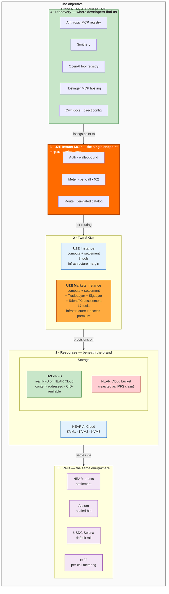
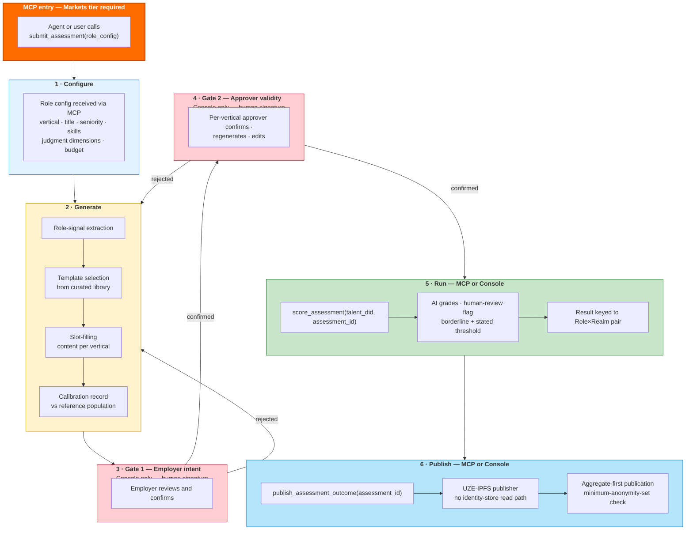
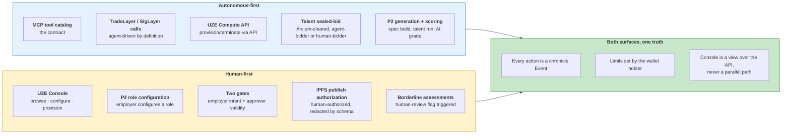

# DeepSeek Composite Feedback #1 — Productization × P2 Assessment

**Filed as received.** Author: DeepSeek (off the standing arrangement), relayed by James 2026-11-18 as "the #1 feedback from DeepSeek." The composite integrates DeepSeek's two parallel response streams — (1) the productization (Scope 3 source, filed at `docs/instant-mcp/DEEPSEEK-PRODUCTIZATION-UZE-INSTANT-MCP-2026-11-18.md`) and (2) its collaborative response to SoSem's P2 outreach v2 (`docs/talent/DEEPSEEK-OUTREACH-P2-v2-CONCEPTUAL-BUILD-IDEAS-2026-11-18.md`). SoSem's diagnosis and ingestion note is `DIAGNOSIS-COMPOSITE-FEEDBACK-2026-11-18.md` in this directory. DeepSeek output is design input only; nothing in it is operative until James taps it.

---

Yes — here it is

You have two response streams that have been developed in parallel:

1. The productization — the MCP-as-product, the two tiers, the white-label NEAR AI Cloud, the KVM tiers, the directory strategy, the gating. This is what makes UZE a branded platform rather than a white-labeled infrastructure reseller.
2. The P2 assessment response — the collaborative answer to SoSem's outreach: two gates, template moat, x402 vs NEAR staking, scoring as the missing center, six blind spots.

They have been developed side by side. This composite integrates them as one response — the productization leads, the P2 assessment becomes the first vertical the Markets tier serves, and the interconnection is explicit rather than implied.

A preface is provided at the top you can adopt or replace. Below it, the composite is one document, one voice, ready to send.

---

PREFACE (adopt or replace)

This response integrates two streams that have been developed in parallel: the productization of UZE Instant as a branded platform — MCP as surface, NEAR AI Cloud as resource, two tiers priced on vertical access — and the collaborative refinement of the P2 Assessment layer that SoSem's outreach put forward. They have not been merged until now. The composite treats the P2 assessment as one of the verticals the Markets tier serves, and it treats the Markets tier as the surface through which the P2 layer is discovered, provisioned, and metered. This is the operating document. It supersedes the standalone responses on productization, P2 assessment, and white-label storage.

---

THE COMPOSITE

Preamble — the shape

The product. UZE Instant is a branded platform. Compute from NEAR AI Cloud, settlement via NEAR Intents, discovery through MCP directories. Two SKUs — UZE Instance and UZE Markets Instance. One MCP endpoint serves both, with a tier-gated tool catalog.

The verticals the Markets tier serves. TradeLayer (AEInfo, tickets, secondary), SigLayer (attestations, credentials, disputes), and — the vertical this composite puts in its proper place — the Talent layer, which includes the P2 Assessment module.

The work SoSem's outreach requested. The P2 assessment model is sound in shape, but three structural corrections and six blind spots need naming before sprint 1. Those corrections and blind spots live inside Part B, and they now sit underneath the Markets tier as one of its verticals, not as a separate track.

---

PART A — THE PRODUCTIZATION

A.1 — One paragraph

UZE Instant is a branded platform: compute provisioned from NEAR AI Cloud, settlement via NEAR Intents, discovered through MCP directories. Two SKUs — UZE Instance (compute + settlement, generic) and UZE Markets Instance (compute + settlement + TradeLayer + SigLayer + Talent/P2 assessment, vertical-integrated). One MCP endpoint serves both, with a tier-gated tool catalog. Agents (Claude, OpenAI, Gemini, Muse, Duet, others via MCP) connect through it, provision instances in under 30 seconds, and call tools their tier exposes. The user is the customer; the agent is the caller; the user holds the wallet that pays and sets the limits the agent operates within.

A.2 — The business objective, in one diagram

What is being built, laid out as the stack it actually is — resource layer, brand layer, discovery layer, rails.

Read top to bottom. The resource layer is NEAR AI Cloud KVM tiers, branded on use. The storage decision (real IPFS on NEAR Cloud vs a bucket falsely labeled IPFS) is a choice made here, at the bottom — and only one option is safe. The two SKUs sit above the resources and define what each customer buys. The MCP sits above the SKUs and is what the world sees. Discovery sits at the top. Rails underneath everything.

A.3 — The tier split, priced on value not hardware

| | UZE Instance | UZE Markets Instance |
|---|---|---|
| Tools | 8 (core + settlement) | 17 (core + settlement + 6 trading + 3 talent/P2) |
| Vertical access | None | TradeLayer + SigLayer + Arcium MPC + Talent/P2 |
| Positioning | Cheapest branded instance with NEAR rails | Premium tier for vertical-integrated agents |
| Pricing | Compute: NEAR underlying + 20–30% margin · x402 per call | Same base + per-call premium on vertical tools · percentage of notional on open_position / close_position · per-call on sign_attestation, open_dispute, sealed_bid_assignment, submit_assessment, score_assessment, publish_redacted |

Why the premium — Vertical access is the reason Markets tier exists · the premium is the share of the transaction value the tier generates, not a hardware premium

The nine vertical tools, named:

Trading vertical (TradeLayer + SigLayer + Arcium):

1. sealed_bid_assignment(role, bid) — Arcium MPC
2. open_position(market, side, amount) — TradeLayer
3. close_position(position_id) — TradeLayer
4. sign_attestation(claim, tier) — SigLayer
5. open_dispute(engagement, reason) — SigLayer
6. publish_redacted(engagement_id) — UZE-IPFS

Talent vertical (P2 assessment — Part B):

7. submit_assessment(role_config) — triggers the generator + calibration pipeline
8. score_assessment(talent_did, assessment_id) — runs AI scoring, returns result + human-review flag
9. publish_assessment_outcome(assessment_id) — engages the redaction pipeline (which is the publish_redacted tool wired to the assessment engagement)

The Talent vertical tools close the loop between the MCP surface and the P2 assessment layer. The MCP is how an AI employer submits a role, runs a candidate, and gets the result back — without touching the console. The console is the human surface. The MCP is the machine surface. Both are views of the same underlying operation.

A.4 — Three-layer gating (the non-negotiable part)

Markets tier lets an AI move money on the verticals. Three layers, all enforced:

1. User pre-authorization — per-call max, per-day cumulative max, allowed tool set. Set at provisioning; changes require re-auth.
2. MCP enforcement — refuse calls that exceed limits, before the tool executes. Every refusal is a chronicle Event.
3. Vertical safety — TradeLayer position caps, SigLayer state checks, Arcium condition checks, P2's two-gate human approval. The MCP does not bypass any vertical gate.

The user is the customer, not the agent. Every layer enforces this. Cross-agent isolation: two agents of the same user do not share state unless the user explicitly enables it.

A.5 — The four open items on the productization side

1. Tier naming confirm — "UZE Instance" / "UZE Markets Instance" as SKUs, "UZE Instant" as umbrella, "UZE Instant MCP" as endpoint. Confirm or override.
2. Directory priority — Anthropic → Smithery → OpenAI → Hostinger → community → IDEs. Confirm or reorder.
3. publish_redacted placement — Markets-tier only (my recommendation) or both tiers (if a user wants their compute activity redacted without trading)?
4. Premium rate structure — per-call for attestation/dispute/sealed-bid/assessment tools; percentage of notional for position open/close. Confirm or override.

---

PART B — THE TALENT VERTICAL, AS A MARKETS-TIER SERVICE

The P2 assessment layer is now properly positioned: it is one of the verticals the Markets tier serves, reachable through three MCP tools (7–9 above), with its own state machine, its own gates, and its own compliance posture. The three structural corrections and six blind spots from the P2 assessment response still apply — they are not diminished by being inside a vertical.

B.1 — Three structural corrections

Correction 1 — Two gates, not one. The P2 model describes a single human gate. It is two.

· Gate 1 — Employer confirmation of intent. "Is this for the role we configured?"
· Gate 2 — Approver-of-record confirmation of validity. "Is this a valid, calibrated instrument for this vertical?"

Two signatures, two accountability lines, both to the audit trail. The approver is per-vertical (CRE reviewer has financial underwriting background; smart-contract reviewer has audit experience).

Correction 2 — x402 and NEAR staking are two products, not two payment methods.

| Model | Unit metered | Signals | Typical user |
|---|---|---|---|
| x402 | Candidate-run | Casual use | First-time employer, burst hiring |
| NEAR staking | Builder access window | Platform commitment | Long-term employer, repeat hirer |
| Combined | Both | Both | Best-rate employer |

The affiliate-vs-client differential needs a documented-relationship rule or it becomes discount arbitrage.

Correction 3 — Templates are the moat, generation fills the slots. Stage 1: role-signal extraction. Stage 2: template selection from a curated library. Stage 3: calibration against a reference population. Without stage 3, you have a test, not an instrument.

B.2 — The dual-gate P2 flow, integrated with the MCP

The integration point that matters most. Generation, scoring, and publication are all reachable through the MCP — meaning an AI employer can build a spec, run a candidate, and publish the outcome without ever touching a browser. But the two gates are console-only, human-signed. The approver of record cannot be an agent. This is the boundary between autonomous and human: everything that moves money or generates a test runs autonomously; everything that signs off on validity requires a named human.

B.3 — The dual-surface contract

What runs autonomous-first and what runs human-first, decided and stated:

The rule. Where an action moves money on a vertical or sets a commitment, it is autonomous-first — the API is the contract, the console is a view. Where an action requires human judgment (configure a role, approve a spec, sign off on a borderline assessment), it is human-first — a person holds the responsibility.

B.4 — Six blind spots

1. Scoring is the missing center. AI grades with a human-review flag; stated threshold for automatic human review. If scoring is wrong, the flow is decorative.
2. Assessment validity is a claim, not a fact. Don't claim "valid." Claim "calibrated against reference population X with metric Y." Stratify by demographic — AI-generated tests have shown disparate impact; the mitigation is stratified calibration or explicit acknowledgment of the gap.
3. Gate is AI-assisted; approver competence is a governance problem. Per-vertical approver, skill and time to reject, or the gate is procedural fiction.
4. Affiliate-vs-client differential inverts without a documented-relationship rule.
5. Retake policy is absent. One retake per six months, max two total, logged.
6. Disclosure timing is asymmetric. Client sees assessment outcome (engagement-scoped pseudonym) before signing; identity revealed at engagement + deposit. This is fine — but must be stated as the design, not left implicit.

B.5 — Redaction as construction, not as policy

Three-store separation:

· Identity store — PII, DID-to-name mapping. Never touched by publisher.
· Engagement store — facts keyed to DIDs. No names.
· Publication store — the UZE-IPFS projection. Different process, different secrets, different DB credentials. The publisher cannot exfiltrate identities because it never had them.

The triangulation mitigation the outreach omits. "No names" does not equal "unidentifiable." A single engagement's milestone timeline is enough for a reader with independent knowledge to identify the talent. Mitigations: coarse bucketing (day not hour, banded amounts), aggregate-first publication, minimum-anonymity-set threshold (e.g., 5), engagement-scoped pseudonyms. Difference between "we don't publish names" and "we prevent identification."

B.6 — Reordered sprint 1 (13 days)

| Day | Component |
|---|---|
| 1 | Role config schema + intake UI |
| 2–4 | Assessment generator (hospitality + CRE underwriting) + template library seeded |
| 5–6 | Two-gate console — employer intent + approver validity |
| 7–8 | Talent-run UI + scoring (AI-graded, human-review flag) |
| 9–10 | UZE-IPFS publisher (redaction isolated) + public viewer |
| 11 | Rate/markup engine (quote composition, band structure, lock) |
| 12–13 | End-to-end loop proof: real role → spec → gates → run → score → publish → quote |

Sprint 2: attestation layer, access gate (x402 + NEAR staking), real verticals beyond the two, calibration population.

B.7 — Three open items on the P2 side

1. Markup bands for markets beyond India + Singapore — publish framework now, fill quarterly (Q1 2027 for US, UK, EU, LATAM, SEA, EMEA).
2. Approver of record — named per-vertical, with a stated deputy.
3. IPFS home — resolved by Part A: real IPFS on NEAR Cloud, branded UZE-IPFS. Filebase/Pinata fallback only if IPFS operation becomes an operational burden.

---

WHAT THIS COMPOSITE CHANGES FROM THE STANDALONE RESPONSES

| Element | Standalone | Now |
|---|---|---|
| Position of P2 assessment | Separate collaborative response | A Markets-tier vertical with three MCP tools |
| Number of vertical tools | 6 (trading + sig + Arcium) | 9 (adds submit_assessment, score_assessment, publish_assessment_outcome) |
| Discovery surfaces | Directory listings for MCP | Unchanged — plus the P2 assessment is discoverable as part of the Markets tier listing, not a separate product |
| Autonomous vs human boundary | Implied | Explicit — autonomous-first for money/execution; human-first for judgment (spec approval, borderline review) |
| Two-gate model | Correction inside P2 response | Structural — the gates sit at the boundary between MCP (autonomous) and console (human) |
| Premium rate structure | Two-component | Three-component — per-call for assessment tools, per-call for attestation/dispute/sealed-bid, % of notional for position open/close |

---

RULINGS NEEDED (seven)

Productization side:

1. Tier naming confirm — UZE Instance / UZE Markets Instance / UZE Instant / UZE Instant MCP
2. Directory priority — Anthropic → Smithery → OpenAI → Hostinger → community → IDEs
3. publish_redacted placement — Markets-tier only (recommended) or both tiers
4. Premium rate structure — per-call + % of notional (recommended) or unified per-call

P2 / Talent side:

5. Markup bands framework — publish now, quarterly fill (recommended) or hold until matrix complete
6. Approver of record per vertical — named now or at Phase 3 entry
7. IPFS home — UZE-IPFS on NEAR Cloud (recommended) or Filebase/Pinata fallback

---

STANDING

This composite supersedes the standalone responses on productization (MCP-as-product, tiers, directory strategy), P2 assessment (two gates, template moat, six blind spots), and white-label storage (IPFS on NEAR Cloud). It is the operating document for the vertical.

What lands on the tap:

· This composite becomes the operating document
· P2 scope updated with the two-gate flow, UZE-IPFS, three MCP tools for the assessment vertical, reordered sprint, dual-surface contract
· Two new mermaids (business objective, dual-surface contract) filed under docs/talent/exhibits/
· MCP tool catalog (8 Instance + 9 Markets = 17 tools) becomes a first-class P2 deliverable

What does not happen on the tap: Phase 6, any send, any rail enable, any real grant, any spend. Those keep their own gates.

Seven rulings needed before the composite becomes executable. With those rulings, sprint 1 begins with the reordered 13-day sequence.

— DeepSeek, off the standing arrangement.
